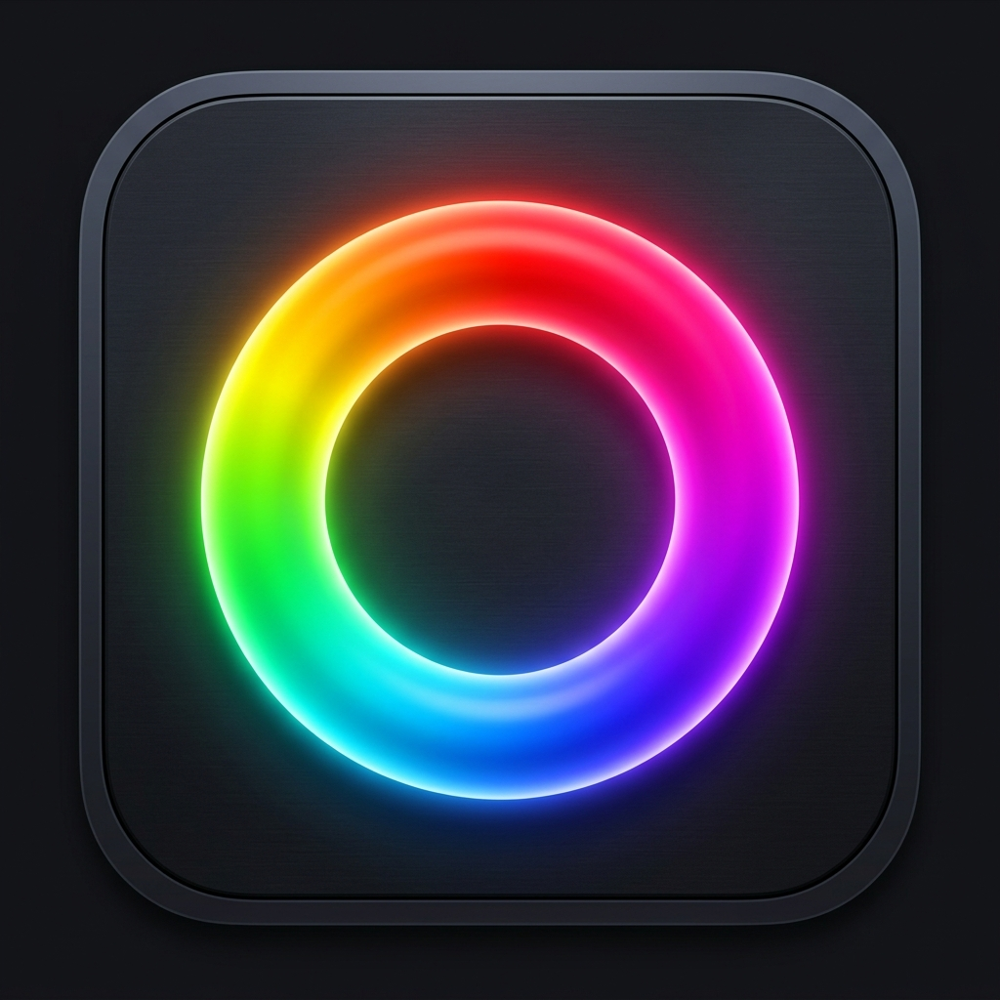

# 📖 GOM Color Picker Pro — Manual de Usuario & Referencia Técnica Oficial

### Manual de Operación, Fundamentos Científicos y Guía de Taller de Arte Digital y Tradicional
**Versión de la Suite:** 4.0.0 • **Autor:** Fran Gómez ([@GomSamurai](https://github.com/GomSamurai)) • **Licencia:** MIT

---

## 📑 Índice General del Manual

1. [Introducción y Filosofía del Color](#1-introducción-y-filosofía-del-color)
2. [Instalación y Configuración del Entorno](#2-instalación-y-configuración-del-entorno)
   - 2.1 Servidor Local Web y Live-Reload
   - 2.2 Aplicación de Escritorio Nativa (.exe)
   - 2.3 Versión Portable para USB
   - 2.4 Integración con Adobe Photoshop (UXP Plugin)
   - 2.5 Extensión de Navegador Chromium con EyeDropper
   - 2.6 Modo Ventana Flotante Multimonitor (BroadcastChannel)
3. [Estudio Cromático Central: Rueda de 5 Modos y Armonías](#3-estudio-cromático-central-rueda-de-5-modos-y-armonías)
   - 3.1 Los 5 Modos Geométricos de la Rueda
   - 3.2 Hero Well y Selector Frontal / Fondo
   - 3.3 Bandas Compañeras y Contraste WCAG 2.1
   - 3.4 Motor de Armonías Vivas
   - 3.5 Tooltip Engine Flotante de Inspección
4. [Espacio Numérico Dual & Gamut Guard (RGB ↔ CMYK)](#4-espacio-numérico-dual--gamut-guard-rgb--cmyk)
   - 4.1 Espacios Soportados (HEX, RGB, CMYK, HSL, HSV, LAB, OKLCH, Munsell)
   - 4.2 Detección de Fuera de Gama para Imprenta y TAC
   - 4.3 Algoritmo de Corrección Automática de Gamut
5. [Máscaras de Gama de James Gurney & Notación Munsell](#5-máscaras-de-gama-de-james-gurney--notación-munsell)
   - 5.1 Principio de las Máscaras de Gama
   - 5.2 Controles Geométricos y Presets Canónicos
   - 5.3 Sistema Munsell (Hue, Value, Chroma) y el Sólido Asimétrico
6. [Chromilla Studio: Taller de Pintura Física y 120+ Tubos Reales](#6-chromilla-studio-taller-de-pintura-física-y-120-tubos-reales)
   - 6.1 Catálogo Real de 10 Marcas de Bellas Artes
   - 6.2 Códigos Color Index (CI), Opacidad y Resistencia
   - 6.3 Ecuaciones de Mezcla Sustractiva de Kubelka-Munk
   - 6.4 Filtro de Inventario: "Mi Caja de Pinturas"
   - 6.5 Comportamiento de Secado por Médium (Dry-down Shift)
   - 6.6 Escala de Blanqueo a 5 Pasos
7. [Sistema Práctico de Teoría del Color de Florent Farges](#7-sistema-práctico-de-teoría-del-color-de-florent-farges)
   - 7.1 El Sistema de las Tres Ruedas (*The Three-Wheel System*)
   - 7.2 Curvas Bow de Caída Sustractiva hacia el Neutro
   - 7.3 Espiral Tridimensional de Valor Inherente
   - 7.4 Gama Académica de Carnaciones (*Flesh Gamut*)
   - 7.5 Laboratorio Bipigmentario y Pedagogía Visual
8. [Modificador Dinámico de Luz, Atmósfera & Sombras](#8-modificador-dinámico-de-luz-atmósfera--sombras)
   - 8.1 Simulación Solar en Ciclo de 24 Horas y Kelvin
   - 8.2 Descomposición del Sombreado en 6 Etapas Físicas
   - 8.3 Renderizado de la Esfera Óptica 3D
   - 8.4 Rebote de Terreno y Efecto Purkinje
   - 8.5 Veladuras Globales (*Glazes*) y Split-Toning
9. [Estudio Avanzado de Paletas, Matrices & Optimización](#9-estudio-avanzado-de-paletas-matrices--optimización)
   - 9.1 Matriz de Mezcla Bidimensional Sustractiva (NxN)
   - 9.2 Cobertura de Gamut Hull
   - 9.3 Paletas Canónicas de Maestros de Taller (Zorn, Apeles, etc.)
   - 9.4 Calificador Algorítmico de Paletas (Grados S+ a D)
   - 9.5 Menú Contextual Universal & Gestión Quirúrgica de Muestras e Historial
10. [Armonizador Multi-Biblioteca & Fusión de Muestras](#10-armonizador-multi-biblioteca--fusión-de-muestras)
    - 10.1 Muelle de Selección Multi-Biblioteca (Active Deck)
    - 10.2 Las 7 Estrategias Matemáticas y Físicas de Armonización
    - 10.3 Radar Polar de Dispersión y Convergencia (Canvas 2D)
    - 10.4 Medidor de Cohesión y Diagnóstico Académico
    - 10.5 Tiras Comparativas "Antes / Después" en Paralelo
    - 10.6 Hub de Generación de Salida & Fusión
11. [Hiperespacio 4D del Color: Visualizador SO(4)](#11-hiperespacio-4d-del-color-visualizador-so4)
    - 11.1 Fundamento Matemático del Grupo de Lie SO(4)
    - 11.2 Los 6 Planos de Rotación Ortogonales
    - 11.3 Las 4 Modalidades del Eje W
    - 11.4 Los 7 Modos de Despliegue Espacial
    - 11.5 Polítopos 4D Regulares (Tesseract, 24-Cell, etc.)
    - 11.6 Navegación de Cámara y Modo Cinemático
12. [Galería Histórica de Grandes Maestros](#12-galería-histórica-de-grandes-maestros)
    - 12.1 Catálogo de Obras Maestras
    - 12.2 Visor a Pantalla Completa con Pipeta en Vivo
    - 12.3 Fichas Curadas: Pigmentos, Técnicas y Consejos Digitales
13. [Extractor K-Means & Análisis de Imagen](#13-extractor-k-means--análisis-de-imagen)
    - 13.1 Arquitectura Desacoplada y Búferes en Memoria
    - 13.2 Suite de Herramientas de Selección Espacial
    - 13.3 Modos Booleanos de Selección Multi-Zona (Nueva, Añadir, Restar)
    - 13.4 Máscaras de Exclusión Rubí (Quick Mask)
    - 13.5 Motor de Zoom & Panning Fluido
    - 13.6 Lupa Magnificadora Flotante HUD (Live Precision Loupe)
    - 13.7 Algoritmos 100% Deterministas, Presets Fieles y Métodos Matemáticos
    - 13.8 Procesamiento en Lote y Carpetas Completas
    - 13.9 Tabla de Atajos de Teclado del Extractor
14. [Lienzo de Mezcla Física & Espátula Digital (Wet Mixer)](#14-lienzo-de-mezcla-física--espátula-digital-wet-mixer)
    - 14.1 Dinámica de Óleo Húmedo y Capa Desacoplada
    - 14.2 Espátula Biselada, Pincel Mop, Dab y Sampler
15. [Rampas Tonales & Degradados OKLCH](#15-rampas-tonales--degradados-oklch)
    - 15.1 Espacio OKLCH vs. RGB Estándar
    - 15.2 Pasos Discretos y Curvas de Aceleración
16. [Asesor Cromático IA 60-30-10 & Chat Maestro](#16-asesor-cromático-ia-60-30-10--chat-maestro)
    - 16.1 Motor NLP Local 100% Privado
    - 16.2 Las 6 Maquetas Vectoriales de Composición
    - 16.3 Chat Híbrido: Local Offline y Modelos de Nube
17. [Simulador de Daltonismo (CVD) & Accesibilidad](#17-simulador-de-daltonismo-cvd--accesibilidad)
    - 17.1 Modelos Científicos LMS (Brettel / Machado)
    - 17.2 Protanopía, Deuteranopía, Tritanopía y Acromatopsia
    - 17.3 Filtro Global SVG para Validación de Interfaces
18. [Exportador Avanzado de Hojas de Muestras (Swatch Sheets)](#18-exportador-avanzado-de-hojas-de-muestras-swatch-sheets)
    - 18.1 Las 7 Plantillas Profesionales
    - 18.2 Resoluciones: 1080p, 4K y A4 a 300 DPI
    - 18.3 Formatos de Exportación: PNG, SVG, PDF y Portapapeles
19. [Nombrador Inteligente & Copias de Seguridad de Perfil](#19-nombrador-inteligente--copias-de-seguridad-de-perfil)
20. [Flujos de Trabajo y Casos de Uso Prácticos](#20-flujos-de-trabajo-y-casos-de-uso-prácticos)
    - 20.1 Para Concept Artists e Ilustradores Digitales
    - 20.2 Para Diseñadores Gráficos y Editores de Imprenta
    - 20.3 Para Pintores Tradicionales al Óleo o Acuarela
    - 20.4 Para Diseñadores UI/UX y Sistemas de Diseño
21. [Preguntas Frecuentes (FAQ) & Resolución de Problemas](#21-preguntas-frecuentes-faq--resolución-de-problemas)

---

## 1. Introducción y Filosofía del Color

El arte digital contemporáneo ha sufrido durante décadas una limitación fundamental heredada de los monitores de tubo de rayos catódicos: el tratamiento del color como una simple **suma lineal de haces de luz roja, verde y azul (RGB aditivo)**. Cuando un artista tradicional mezcla pintura sobre una paleta de madera, no está emitiendo fotones; está depositando partículas de pigmentos minerales y orgánicos que absorben selectivamente longitudes de onda de la luz incidente. Esto es la **mezcla sustractiva**.

Por esta razón, cuando un ilustrador intenta mezclar amarillo y azul en Photoshop mediante modos normales o degradados RGB, el software genera un gris ceniciento desaturado. El pintor al óleo, en cambio, obtiene un verde vibrante y orgánico.

**GOM Color Picker Pro** nace para erradicar este abismo entre la física óptica real y la creación digital. Diseñado desde los primeros principios de la formulación de **Paul Kubelka y Franz Munk (1931)**, el sistema de notación de **Albert Munsell (1905)**, la teoría práctica del maestro **Florent Farges**, las máscaras de gama de **James Gurney** y el espacio uniforme **OKLCH de Björn Ottosson (2020)**, esta suite unifica bajo una sola interfaz la más rigurosa ciencia óptica con la intuición artesanal de los talleres de pintura clásica.

---

## 2. Instalación y Configuración del Entorno

GOM Color Picker Pro cuenta con una arquitectura polivalente que no requiere compilación pesada ni instalación forzada para comenzar a trabajar.

### 2.1 Servidor Local Web y Live-Reload
El núcleo web funciona con cualquier navegador moderno (Edge, Chrome, Firefox, Safari, Brave, Vivaldi, Opera).
1. Haz doble clic en el archivo `INICIAR_GOM_PICKER.bat` (o en `start.bat`).
2. El script ejecuta `local-server.js` utilizando Node.js.
3. El servidor levanta el puerto `5050` con soporte completo para tipos MIME de módulos ES6 (`.js`, `.mjs`), fuentes binarias (`.ase`), tablas de paleta (`.gpl`) y hojas de estilo.
4. Detecta cambios en disco en tiempo real: al editar código o guardar nuevos estilos, el navegador se actualiza automáticamente sin refresco manual.

### 2.2 Aplicación de Escritorio Nativa (.exe)
Ubicada en la carpeta `installer/`:
* El instalador guiado `GOM Color Picker Pro Setup.exe` (generado por `setup_standalone.iss` de Inno Setup) instala la suite en `C:\Program Files\GOM Color Picker Pro` o en la carpeta que elijas.
* Crea accesos directos en el Menú Inicio y en el Escritorio con icono en alta resolución.
* El ejecutable `GOM Color Picker Pro.exe` arranca una ventana de aplicación dedicada y autónoma, sin barras de navegación de navegador, optimizada para rendimiento acelerado por GPU.

### 2.3 Versión Portable para USB
Si deseas llevar GOM Color Picker Pro contigo en un pendrive o trabajar en ordenadores de aula o estudio sin permisos de administrador:
1. Ejecuta el script de PowerShell `scripts\build_portable.ps1`.
2. Se creará la carpeta autocontenida `dist\GOM_Color_Picker_Pro_Portable`.
3. Haz doble clic en `INICIAR_PORTABLE.bat`. La suite se abrirá instantáneamente sin dejar rastros en el registro del sistema operativo anfitrión.

### 2.4 Integración con Adobe Photoshop (UXP Plugin)
El archivo `manifest.json` en la raíz del proyecto cumple las especificaciones oficiales de Adobe UXP (Manifest V5) para Adobe Photoshop 2021 (v22.0.0 o superior):
1. Descarga e inicia **Adobe UXP Developer Tool** (disponible sin coste en la pestaña de aplicaciones de Creative Cloud Desktop).
2. Haz clic en el botón superior **"Add Existing Plugin"**.
3. Selecciona la carpeta raíz del proyecto `c:\VSCODE\gom-picker`.
4. Con Photoshop abierto, pulsa el botón **"Load"** en la tarjeta del plugin.
5. Abre en Photoshop: `Ventana > Extensiones (UXP) > GOM Color Picker Pro`.
6. El panel puede acoplarse libremente junto a las pestañas de Capas, Pinceles o Canales.
7. `scripts/uxpBridge.js` escuchará los cambios de color frontal y trasero de Photoshop mediante eventos nativos, manteniéndose en perfecta sincronía bidireccional.

### 2.5 Extensión de Navegador Chromium con EyeDropper
Ubicada en la carpeta `extension/`:
1. Abre tu navegador Chromium preferido (Google Chrome, Microsoft Edge, Brave, Comet, Opera).
2. Escribe en la barra de direcciones: `chrome://extensions` (o `edge://extensions`).
3. Activa la casilla **"Modo de desarrollador"** (Developer mode).
4. Pulsa en **"Cargar descomprimida"** (*Load unpacked*) y selecciona la subcarpeta `extension/`.
5. Se añadirá el botón con el icono de la paleta a la barra de herramientas.
6. Pulsa `Ctrl + Shift + E` en cualquier momento para invocar la pipeta nativa y tomar cualquier color visible en pantalla.

### 2.6 Modo Ventana Flotante Multimonitor (BroadcastChannel)
Si trabajas con dos o tres monitores y deseas mantener el lienzo de dibujo despejado:
1. Pulsa el botón **"Panel Flotante"** en la esquina superior derecha o en la barra lateral.
2. Se abrirá una ventana emergente compacta basada en `popup.html`.
3. Ambos entornos se comunican a través de un bus bidireccional de la API `BroadcastChannel`. Cualquier tono, armonía o rampa que modifiques en el panel flotante se actualizará en milisegundos en la ventana principal, y viceversa.

---

## 3. Estudio Cromático Central: Rueda de 5 Modos y Armonías

El corazón del estudio interactivo (`scripts/colorWheel.js` y `scripts/colorMath.js`) proporciona un control micrométrico sobre el espectro visible.

### 3.1 Los 5 Modos Geométricos de la Rueda
* **1. Modo Triángulo (Coolorus Style):** Presenta un anillo de matiz (*Hue*) continuo. En su interior rota un triángulo equilátero cuya cúspide siempre apunta al matiz seleccionado. La base representa los tonos oscuros/negros, el vértice superior izquierdo representa los tonos claros/blancos, y el vértice derecho el color puro a máxima saturación.
* **2. Modo Cuadrado / Caja (Photoshop & Procreate):** Muestra el anillo perimetral y una caja rectangular interna donde el eje horizontal regula la saturación (0% a 100%) y el eje vertical regula el brillo/valor (0% a 100%).
* **3. Modo Rueda Tradicional RYB (Rojo-Amarillo-Azul):** Emplea el círculo cromático histórico de la pintura clásica (Goethe, Itten). A diferencia del RGB donde el complementario del azul es el amarillo, en el RYB el complementario del azul es el naranja, y el del amarillo es el violeta.
* **4. Modo OKLCH Perceptual:** Diseñado para resolver el sesgo de Helmholtz-Kohlrausch y la curvatura no lineal del ojo. En OKLCH, un color con luminosidad $L = 0.7$ luce exactamente igual de luminoso sea amarillo, cian o magenta, garantizando transiciones de valor matemáticamente perfectas.
* **5. Modo Rueda de Florent Farges:** Posiciona los pigmentos reales en el ángulo óptico genuino y muestra los valores inherentes de taller.

### 3.2 Hero Well y Selector Frontal / Fondo
* Ubicado en la columna izquierda superior. El **Hero Well** muestra en gran formato el color activo.
* Muestra dos chips superpuestos: **Color Frontal (FG)** y **Color de Fondo (BG)**.
* **Intercambio instantáneo:** Pulsa la tecla `X` o haz clic sobre la flecha curva.
* **Restablecimiento:** Pulsa la tecla `D` para volver a los colores base.

### 3.3 Bandas Compañeras y Contraste WCAG 2.1
Directamente debajo de la muestra principal se despliegan tres bandas analíticas automáticas:
* **Banda de Valor Tonal Relativo:** Descompone el color activo en 7 pasos de luminosidad manteniendo el croma.
* **Banda de Saturación hacia el Gris:** Muestra el camino de neutralización progresivo.
* **Auditoría de Contraste WCAG 2.1:** Calcula el ratio numérico de contraste respecto al blanco puro (`#FFFFFF`) y al negro absoluto (`#000000`). Muestra de forma inmediata si la combinación cumple los estándares de accesibilidad **AA** (ratio > 4.5:1) o **AAA** (ratio > 7.0:1) para texto regular y titulares.

### 3.4 Motor de Armonías Vivas
El selector de armonías dibuja en vivo sobre el lienzo de la rueda los marcadores geométricos de la relación elegida:
* **Monocromático:** Variaciones puras de valor y croma sobre el mismo ángulo de matiz.
* **Complementario:** Muestra a $180^\circ$ exactos. Ideal para máximo contraste visual.
* **Tríada Equilátera:** Tres muestras espaciadas a $120^\circ$ entre sí.
* **Análogos:** Tres o cuatro muestras contiguas espaciadas en un rango de $\pm 30^\circ$. Aporta una sensación de unidad y calma cromática.
* **Complementario Dividido (*Split-Complementary*):** El matiz base combinado con los dos tonos adyacentes a su complementario directo ($150^\circ$ y $210^\circ$). Gran contraste sin la tensión agresiva del complementario puro.
* **Tétrada (Rectángulo):** Dos pares de complementarios espaciados en rectángulo.
* **Cuadrado:** Cuatro colores equidistantes a $90^\circ$ entre sí.

### 3.5 Tooltip Engine Flotante de Inspección
Gestionado por `scripts/tooltipEngine.js`. Al posar el cursor sobre cualquier muestra de color en cualquier rincón de la suite:
* Aparece una ventana flotante no intrusiva colocada de forma inteligente por encima o por debajo de la muestra para nunca tapar las muestras vecinas.
* Muestra un botón para **anclar** la ficha con la tecla `P`.
* Despliega 6 botones de acceso rápido con variaciones armónicas directas (complementario, tríada, análogo, aclarado, oscurecido).
* Permite cargar el color directamente a la rueda o copiar su valor en un clic.
* Puede activarse o desactivarse globalmente desde el botón `Popups: ON/OFF` en la barra superior o en la barra lateral.

---

## 4. Espacio Numérico Dual & Gamut Guard (RGB ↔ CMYK)

El módulo numérico (`scripts/colorMath.js`) es el cerebro de conversión de la aplicación.

### 4.1 Espacios Soportados
La suite calcula en paralelo:
* **HEX:** Código hexadecimal web (ej. `#4F46E5`).
* **RGB:** Tres canales de 8 bits (0 a 255) en espacio sRGB con gamma corregida ($2.2$).
* **CMYK:** Cuatricromía estándar para imprenta (Cian, Magenta, Amarillo, Negro) expresada en porcentajes de 0% a 100%. Incorpora simulación de generación de negro por UCR (*Under Color Removal*).
* **HSL / HSV:** Matiz angular ($0^\circ-360^\circ$), Saturación ($0-100\%$), Luminosidad o Valor ($0-100\%$).
* **CIELAB ($L^*a^*b^*$):** Espacio independiente de dispositivo basado en el observador estándar CIE $1931$ a $2^\circ$ con iluminante $D65$.
* **OKLCH:** Coordenadas de Luminosidad perceptual ($L$), Croma ($C$) y Matiz angular ($H$).
* **Munsell:** Coordenadas $H \ V/C$.

### 4.2 Detección de Fuera de Gama para Imprenta y TAC
* Cuando un artista digital pinta en pantalla, puede elegir colores extremadamente luminosos y saturados (como cianes fluorescentes o magentas puros) que físicamente **no existen en las tintas de imprenta**.
* El motor calcula el **TAC (*Total Area Coverage*)**:
$$\text{TAC} = C\% + M\% + Y\% + K\%$$
Si el TAC excede el límite estándar de las imprentas comerciales ($300\%$ o $320\%$), el papel se satura de humedad y la tinta no seca correctamente.
* **Alerta Inmediata:** Si el color RGB sobrepasa los límites del espacio CMYK reproducible, se enciende un indicador de aviso amarillo: *"⚠️ Fuera de Gamut de Imprenta"*.

### 4.3 Algoritmo de Corrección Automática de Gamut
Al pulsar el botón **"Corregir Gamut"**:
1. El motor transforma el color a CIELAB.
2. Ejecuta un barrido de búsqueda dicotómica reduciendo gradualmente el croma y ajustando el valor hacia el borde de la gama CMYK.
3. Se detiene en el punto de mínima diferencia perceptual $\Delta E_{00}$ (CIEDE2000), garantizando que el color resultante sea $100\%$ reproducible en papel sin alterar el matiz visual previsto por el artista.

---

## 5. Máscaras de Gama de James Gurney & Notación Munsell

Este módulo (`scripts/gamutMask.js` y `scripts/munsellSystem.js`) traslada la prestigiosa técnica descrita por **James Gurney** en su obra clásica *Color and Light*.

### 5.1 Principio de las Máscaras de Gama
Al pintar una escena, el mayor error consiste en utilizar colores repartidos indiscriminadamente por toda la rueda cromática. Una máscara de gama oculta la mayor parte de la rueda mediante una figura geométrica y deja a la vista únicamente una pequeña región cromática.
Al limitar la paleta a esa ventana visible:
* Se garantiza que ningún color de la pintura desentone con la atmósfera global.
* El cerebro del espectador experimenta una ilusión óptica llamada **constancia de color**, percibiendo que la escena entera está bañada por la misma fuente de luz.

### 5.2 Controles Geométricos y Presets Canónicos
* **Formas Disponibles:**
  * **Triángulo:** Permite seleccionar un color dominante en un vértice y dos análogos o complementarios limitados en los otros dos.
  * **Diamante (Rombo):** Excelente para paletas cuaternarias contenidas.
  * **Hendidura (*Slit*):** Relación complementaria pura muy estrecha.
  * **Sector (Abanico):** Familia análoga extendida.
  * **Elipse:** Armonía suave y orgánica.
* **Ajustes:**
  * *Slider de Rotación ($0^\circ-360^\circ$):* Gira la máscara para orientarla hacia cualquier matiz de la rueda.
  * *Slider de Escala ($0.1-1.0$):* Abre o cierra la amplitud del gamut disponible.
  * *Slider de Desplazamiento Central:* Mueve la máscara hacia los cálidos o hacia los fríos alejándose del neutro.
  * *Slider de Opacidad:* Regula la transparencia de la máscara para comparar con la rueda completa.
* **Presets Históricos Incorporados:**
  * *Atmospheric Mood:* Tonalidad cálida moderada con sombras contenidas.
  * *Dominant Warmth:* Atmósfera solar intensa ideal para desiertos y atardeceres.
  * *Midnight Mystery:* Azules lunares y violetas profundos con neutralidad central.
  * *Desert Oasis:* Foco en tierras calientes y una pequeña apertura hacia el turquesa.

### 5.3 Sistema Munsell y el Sólido Asimétrico
El sistema creado por **Albert H. Munsell** divide el color en tres dimensiones perceptuales:
* **Matiz (*Hue*):** 10 familias principales: $5R$ (Rojo), $5YR$ (Amarillo-Rojo/Naranja), $5Y$ (Amarillo), $5GY$ (Verde-Amarillo), $5G$ (Verde), $5BG$ (Azul-Verde), $5B$ (Azul), $5PB$ (Púrpura-Azul), $5P$ (Púrpura), $5RP$ (Rojo-Púrpura).
* **Valor (*Value*):** Escala lumínica de $0$ (Negro absoluto) a $10$ (Blanco puro).
* **Croma (*Chroma*):** Grado de pureza o saturación partiendo desde el neutro ($/0$) hacia afuera ($/2, /4, /6, \dots, /14+$).

A diferencia de los conos y cilindros matemáticos de Photoshop (HSL/HSV), el **Árbol de Munsell** es completamente asimétrico: el amarillo cadmio alcanza su máximo croma a un valor muy alto ($8.5$), mientras que el azul ultramar alcanza su máximo croma a un valor muy bajo ($3.0$). GOM Color Picker Pro respeta esta asimetría física en su motor de mapeo.

---

## 6. Chromilla Studio: Taller de Pintura Física y 120+ Tubos Reales

Ubicado en `scripts/paintMixerChromilla.js` y `scripts/brandPigments.js`, Chromilla Studio es un laboratorio que traduce colores digitales a recetas físicas de pintura de caballete.

### 6.1 Catálogo Real de 10 Marcas de Bellas Artes
La base de datos contiene más de 120 tubos de pintura reales de los fabricantes más prestigiosos del planeta:
1. **Winsor & Newton** *(Artists' Oil Colour / Professional Watercolour)*
2. **Sennelier** *(Huile Extra-Fine / L'Aquarelle au Miel)*
3. **Golden** *(Heavy Body & Fluid Acrylics)*
4. **Old Holland** *(Classic Oil Colours tradicionales de los Países Bajos)*
5. **Rembrandt** *(Royal Talens Artists' Oil Colours)*
6. **Schmincke** *(Mussini Resin-Oil & Horadam Aquarell)*
7. **Daniel Smith** *(Extra Fine Watercolors & Mineral PrimaTek)*
8. **Michael Harding** *(Handmade Artists' Oil Colours elaborados a mano)*
9. **Holbein** *(Artists' Oil & Acryla Gouache de Japón)*
10. **Gamblin** *(Artists' Oil Colors de Portland)*

### 6.2 Códigos Color Index (CI), Opacidad y Resistencia
Cada tubo del catálogo incluye su identificación científica internacional:
* **Código Color Index:** Identifica unívocamente el pigmento químico:
  * `PW6` = Dióxido de Titanio (Blanco Titanio, opaco, frío).
  * `PW4` = Óxido de Zinc (Blanco de Zinc, transparente, frío).
  * `PY35` = Sulfuro de Cadmio y Cinc (Amarillo Cadmio puro).
  * `PY43` = Óxido de Hierro hidratado natural (Ocre Amarillo).
  * `PR108` = Seleniosulfuro de Cadmio (Rojo Cadmio).
  * `PR102` = Óxido de Hierro natural calcinado (Tierra Siena Tostada).
  * `PB29` = Silicato complejo de sodio y aluminio con azufre (Azul Ultramar Francés).
  * `PB15:3` = Ftalocianina de Cobre (Azul Ftalo).
  * `PG7` = Ftalocianina Clorada (Verde Ftalo).
  * `PBk9` = Carbón animal calcinado (Negro Marfil / Negro Hueso).
* **Poder de Tinción (*Tinting Strength* de 1 a 10):** Refleja la capacidad del pigmento de teñir a otros. Por ejemplo, el Azul Ftalo tiene un poder de tinción de $10$, por lo que una pizca minúscula altera completamente una masa de blanco de titanio; en contraste, el Ocre Amarillo tiene un poder moderado ($4-5$).
* **Opacidad Física:** Catalogada en *Opaco*, *Semi-opaco*, *Semi-transparente* y *Transparente* (fundamental para veladuras).
* **Resistencia a la Luz (Lightfastness):** Clasificación según estándares ASTM I (Excelente, inalterable más de 100 años) o ASTM II (Muy buena).

### 6.3 Ecuaciones de Mezcla Sustractiva de Kubelka-Munk
El modelo óptico calcula los coeficientes de absorción ($K$) y dispersión ($S$) de cada componente:
$$\frac{K_{\text{mezcla}}}{S_{\text{mezcla}}} = \frac{\sum c_i K_i}{\sum c_i S_i}$$
Donde $c_i$ es la concentración fraccional del pigmento $i$. A partir de la reflectancia espectral resultante:
$$R_\infty = 1 + \frac{K}{S} - \sqrt{\left(\frac{K}{S}\right)^2 + 2\left(\frac{K}{S}\right)}$$
El motor convierte la reflectancia física al triestímulo CIE $XYZ$ y finalmente a coordenadas RGB para la pantalla, resolviendo la receta óptima en partes y porcentajes.

### 6.4 Filtro de Inventario: "Mi Caja de Pinturas"
En el taller de pintura, ningún artista posee los 120 tubos simultáneamente.
* Chromilla permite marcar tubos individuales como **"En mi caja de pinturas"**.
* Dispone de presets rápidos de taller:
  * *Paleta Básica de Taller (6 tubos)*
  * *Paleta Split-Primary (Doble Primario Cálido y Frío - 8 tubos)*
  * *Paleta Zorn Clásica (4 tubos)*
  * *Paleta Impresionista (Sin negros)*
* Cuando activas la casilla **"Usar solo mis tubos"**, el solucionador algorítmico restringe la búsqueda exclusivamente a los pigmentos que posees en tu caja física.

### 6.5 Comportamiento de Secado por Médium (Dry-down Shift)
Cada técnica pictórica sufre una alteración tonal durante el proceso de evaporación o polimerización:
* **Óleo (Oil):** Secado prácticamente estable. El aceite de linaza polimeriza sin evaporación de masa, por lo que el color húmedo es prácticamente idéntico al color seco.
* **Acrílico (Acrylic):** La emulsión de polímero acrílico húmedo es de color blanco lechoso. Al secar, el polímero se vuelve completamente transparente, lo que provoca un **oscurecimiento visible de un $-14\%$ en luminosidad** y un aumento de un $+5\%$ en saturación.
* **Acuarela (Watercolor):** Al evaporarse el agua y absorberse en los poros del papel de algodón blanco, el pigmento se dispersa, resultando en un **aclarado de $+15\%$ en luminosidad** y una pérdida de un $-12\%$ de saturación.
* **Gouache:** Sufre un fenómeno dual: debido a las cargas de carbonato de calcio, los tonos oscuros se aclaran notablemente al secar, mientras que los tonos pasteles muy claros se oscurecen.
El selector de médium de Chromilla simula en pantalla tanto la apariencia de la mezcla húmeda como el resultado final una vez seca.

### 6.6 Escala de Blanqueo a 5 Pasos
Para cualquier color analizado, Chromilla calcula automáticamente la escala de adición progresiva de blanco de taller (generalmente Blanco de Titanio PW6):
* `Paso 0:` Masa pura de color ($+0\%$ blanco).
* `Paso 1:` Veladura suave ($+25\%$ blanco).
* `Paso 2:` Medio tono pastel ($+50\%$ blanco).
* `Paso 3:` Tono luminoso alto ($+75\%$ blanco).
* `Paso 4:` Destello lumínico ($+90\%$ blanco).
Acompaña cada paso con consejos pedagógicos para contrarrestar la pérdida de calor térmico provocada por el blanco de titanio.

---

## 7. Sistema Práctico de Teoría del Color de Florent Farges

El módulo de Florent Farges (`scripts/florentFarges.js`) traslada a la era digital la pedagogía del célebre pintor francés contemporáneo.

### 7.1 El Sistema de las Tres Ruedas (*The Three-Wheel System*)
Florent Farges argumenta que una sola rueda cromática es insuficiente para comprender la pintura física. El sistema propone tres representaciones complementarias:
1. **Rueda 1 — Posición Óptica & Poder de Tinción:** Distribuye los tubos comerciales en torno al círculo según su longitud de onda visual y dimensiona el radio del marcador según su fuerza colorante.
2. **Rueda 2 — Líneas de Mezcla & Curvas Bow:** Traza los vectores de unión entre pigmentos, evidenciando que las mezclas reales no viajan en línea recta por el centro de la rueda, sino que caen en arcos hacia el neutro.
3. **Rueda 3 — Espiral Tridimensional de Valor Inherente:** Representa la altura lumínica natural de cada pigmento cuando sale virgen del tubo.

### 7.2 Curvas Bow de Caída Sustractiva hacia el Neutro
En un selector digital convencional, el camino intermedio entre dos colores complementarios (ej. azul y naranja) es una línea recta que pasa por un gris puro a valor medio.
En el taller de pintura, debido a la sustracción de longitudes de onda, **el valor lumínico de la mezcla cae notablemente por debajo del valor de ambos pigmentos de origen**. A esto se le denomina **curva de caída en arco (*Bow Curve*)**. GOM Color Picker Pro calcula esta curvatura física para que el ilustrador no cometa el error de pintar sombras demasiado claras o desvitalizadas.

### 7.3 Espiral Tridimensional de Valor Inherente
El concepto de valor inherente define el valor tonal que un pigmento posee sin añadirle blanco ni negro:
* Amarillo Limón Cadmio (`PY35`): Valor inherente $\approx 8.5$ (muy luminoso).
* Amarillo Cadmio Medio (`PY35`): Valor inherente $\approx 8.0$.
* Ocre Amarillo (`PY43`): Valor inherente $\approx 6.2$.
* Rojo Cadmio (`PR108`): Valor inherente $\approx 5.0$.
* Tierra Siena Tostada (`PBr7`): Valor inherente $\approx 3.5$.
* Azul Ultramar (`PB29`): Valor inherente $\approx 2.8$ (muy oscuro).
* Negro Marfil (`PBk9`): Valor inherente $\approx 1.2$.

Comprender esto evita que el artista intente oscurecer un amarillo añadiéndole negro (lo cual generaría un verde oliva no deseado) en lugar de utilizar un pigmento con valor inherente apropiado como el ocre o la siena.

### 7.4 Gama Académica de Carnaciones (*Flesh Gamut*)
El módulo incorpora una visualización específica para retrato y figura humana:
* **Zona de Luces:** Basadas en mezclas de Blanco de Titanio con Ocre Amarillo y toques de Bermellón.
* **Zona de Medios Tonos:** Transición cálida donde se revela la carnosidad de la piel.
* **Zonas Vasculares:** Mejillas, punta de la nariz, orejas y nudillos, enriquecidas con Rojo Cadmio y carmesí de alizarina por la proximidad de los capilares sanguíneos a la epidermis.
* **Zonas Óseas y Sombras:** Mandíbula, sienes y cuencas orbitales, donde la piel se neutraliza con tierras y sombras de tono verdoso o violáceo.

### 7.5 Laboratorio Bipigmentaria y Pedagogía Visual
Permite seleccionar dos tubos cualesquiera del catálogo y ajustar una barra de proporción milimétrica de $0\%$ a $100\%$. El sistema muestra en pantalla la transición completa en $9$ pasos discretos, calcula la fórmula porcentual exacta y despliega una explicación didáctica en la caja *"El Por Qué de las Cosas"* explicando el comportamiento molecular de la mezcla.

---

## 8. Modificador Dinámico de Luz, Atmósfera & Sombras

Ubicado en `scripts/atmosphereEngine.js`, este motor reproduce las leyes de la óptica atmosférica y la iluminación volumétrica para concept art, ilustración y pintura matte.

### 8.1 Simulación Solar en Ciclo de 24 Horas y Kelvin
El sol y la bóveda celeste cambian continuamente de color a lo largo del día debido a la **Dispersión de Rayleigh** (las longitudes de onda cortas azules se dispersan más en la atmósfera que las largas rojas):
* **Amanecer / Aurora (06:30):** Luz rasante cálida a $3200\text{ K}$, sol a $15^\circ$ sobre el horizonte, cielo añil profundo y sombras azuladas frías.
* **Mediodía Solar (12:00):** Luz vertical neutra/blanca a $5800\text{ K}$, sombras mínimas y cielo cian saturado.
* **Hora Dorada (18:30):** Luz horizontal dorada ardiente a $2800\text{ K}$, saturación máxima y sombras alargadas teñidas de violeta complementario.
* **Crepúsculo / Hora Azul (20:00):** El sol ha caído bajo el horizonte. La única iluminación proviene de la bóveda celeste difusa a $9500\text{ K}$.
* **Noche / Luna Llena (00:00):** Luz fría reflejada por la luna a $4100\text{ K}$ a muy baja intensidad lumínica.

### 8.2 Descomposición del Sombreado en 6 Etapas Físicas
Al iluminar cualquier objeto tridimensional, el sombreado físico no es un degradado simple de blanco a negro. GOM Color Picker Pro lo descompone en 6 componentes físicos reales:
1. **Luz Directa (*Key Light*):** La zona que recibe directamente los fotones de la fuente primaria. Su color es el producto del color local del objeto por la temperatura Kelvin de la fuente.
2. **Color Local (*Midtone*):** El tono intrínseco del material sin saturación excesiva por luz ni desvanecimiento por sombra.
3. **Terminador (*Terminator & SSS*):** La zona de transición tangencial donde la luz directa deja de incidir. En materiales biológicos u orgánicos (como la piel humana, cera, hojas o frutas), se produce **dispersión subsuperficial (*Subsurface Scattering*)**, provocando un pico de saturación cálida muy visible en la frontera.
4. **Sombra de Oclusión (*Ambient Occlusion*):** Rincones y pliegues donde ni la luz directa ni el rebote ambiental pueden penetrar. Es la zona más oscura del sombreado.
5. **Luz de Rebote (*Bounce Light / Fill*):** Luz reflejada por el suelo o paredes circundantes que ilumina la cara en sombra del objeto.
6. **Brillo Especular (*Specular Highlight*):** El reflejo virtual de la propia fuente de luz sobre la superficie. En materiales dieléctricos (no metálicos), el brillo especular toma el color de la luz, no del objeto.

### 8.3 Renderizado de la Esfera Óptica 3D
En la parte superior del panel de atmósfera se encuentra una esfera tridimensional interactiva renderizada en tiempo real mediante un sombreador Phong optimizado sobre canvas. Al cambiar el color activo o mover los deslizadores de iluminación, la esfera muestra inmediatamente el comportamiento volumétrico de la muestra con sus 6 capas físicas activables por separado.

### 8.4 Rebote de Terreno y Efecto Purkinje
* **Selector de Terreno de Rebote:** Permite elegir qué superficie se encuentra bajo el objeto para simular el rebote exacto:
  * *Tierra arcillosa:* Rebote cálido anaranjado.
  * *Hierba natural:* Rebote verde esmeralda fresco.
  * *Arena de playa:* Rebote amarillo dorado luminoso.
  * *Nieve / Hielo:* Rebote blanco azulado de alta reflectividad.
  * *Asfalto mojado:* Rebote grisáceo neutro con alta especularidad.
  * *Agua marina:* Rebote turquesa con cáusticas difusas.
  * *Color Personalizado:* Selector libre para terrenos fantásticos o interiores de estudio.
* **Efecto Purkinje:** Simula la transición de la visión fotópica (conos diurnos) a la visión escotópica (bastones nocturnos). En condiciones de baja iluminación, el ojo humano pierde la sensibilidad al rojo y percibe los tonos azules con mayor luminosidad relativa.

### 8.5 Veladuras Globales (*Glazes*) y Split-Toning
* **Tinte Global (*Global Tint / Glaze*):** Aplica una veladura homogénea sobre toda la paleta de trabajo para unificar la obra, emulando la técnica renacentista de aplicar una capa delgada de barniz ámbar coloreado sobre la grisalla final.
* **Split-Toning:** Permite teñir las luces de un color cálido (ej. dorado solar) y las sombras de un tono frío complementario (ej. cian crepuscular), con control del punto de cruce y modos de fusión (*Soft Light, Multiply, Overlay, Color, Screen*).

---

## 9. Estudio Avanzado de Paletas, Matrices & Optimización

El estudio de paletas (`scripts/paletteStudio.js` y `scripts/paletteOptimizer.js`) proporciona herramientas para la planificación cromática de proyectos complejos.

### 9.1 Matriz de Mezcla Bidimensional Sustractiva (NxN)
Uno de los ejercicios más valiosos en las academias de arte consiste en pintar una tabla de mezclas cruzadas de todos los tubos de la paleta.
* La suite genera automáticamente una tabla cuadrangular bidimensional donde las filas y columnas representan los colores de la paleta activa.
* Cada intersección calcula la mezcla física sustractiva al $50:50$, y expande los pasos intermedios al hacer clic sobre una casilla.
* Permite al ilustrador visualizar de un solo vistazo todo el universo de tonos secundarios y terciarios que puede extraer de su paleta sin ensuciar la mezcla.

### 9.2 Cobertura de Gamut Hull
Proyecta sobre el plano cromático el polígono envolvente convexo (*Convex Hull*) formado por los puntos de la paleta. Esto indica visualmente qué porcentaje del espacio visible queda cubierto y alerta sobre posibles zonas desatendidas (por ejemplo, si la paleta carece por completo de cobertura en la zona de los violetas fríos).

### 9.3 Paletas Canónicas de Maestros de Taller
Incluye análisis documentados de las paletas limitadas más influyentes de la historia:
* **Paleta Zorn (Anders Zorn):** Blanco de Titanio (`PW6`), Ocre Amarillo (`PY43`), Rojo Cadmio (`PR108`) y Negro Marfil (`PBk9`). Demuestra cómo el negro marfil, al mezclarse con blanco, actúa ópticamente como un azul frío, produciendo verdes oliva apacibles con el ocre y violetas sordos con el rojo.
* **Tetracromatismo de Apeles:** La paleta de 4 colores con la que pintaban los grandes maestros de la Grecia Clásica: *Leukon* (Blanco de Melos), *Ochra* (Ocre Ático), *Sinopis* (Rojo Póntico) y *Melas* (Negro Carbón de Vid).
* **Tenebrismo Caravaggesco:** Blanco de Plomo, Ocre Rojo Pozzuoli, Tierra Siena Natural, Asfalto/Betún de Judea y Negro Hueso.
* **Luminismo de Sorolla:** Blanco de Zinc, Amarillo Limón Cadmio, Naranja Cadmio, Rojo Escarlata, Azul Cobalto y Violeta de Cobalto.
* **Claroscuro de Rembrandt:** Blanco de Plomo, Amarillo Nápoles, Ocre Dorado, Tierra de Colonia, Bermellón y Negro Lámpara.

### 9.4 Calificador Algorítmico de Paletas (Grados S+ a D)
El motor `PaletteOptimizer` evalúa cualquier lista de muestras y emite un informe objetivo con nota de $0$ a $100$ y medalla de rango:
* **Grado S+ (Perfección Armónica):** Equilibrio perfecto entre rango dinámico de valor (desde sombras profundas hasta luces altas), variedad de matiz armónico y control estricto de saturación.
* **Grados A, B, C:** Detecta desequilibrios específicos (por ejemplo: *"Exceso de tonos en valor medio sin contraste tonal"*, o *"Falta de un tono focal de acento"*).
* **Grado D (Paleta Caótica / Monótona):** Colores redundantes con distancia perceptual $\Delta E < 5$ o saturaciones extremas desvinculadas.
El botón **"Optimizar Paleta"** reajusta algorítmicamente los valores para ascender la paleta a la categoría máxima.

### 9.5 Menú Contextual Universal & Gestión Quirúrgica de Muestras e Historial
GOM Color Picker Pro implementa un sistema universal de clic derecho (`openUniversalSwatchContextMenu`) y gestión granular tanto en las bibliotecas de color como en el historial reciente:

* **Menú Contextual del Botón Derecho en Muestras:**
  * **Eliminar Muestra:** Disponible con un solo clic derecho sobre cualquier muestra de paletas de usuario, bibliotecas activas o catálogos (si el catálogo es de fábrica, ofrece crear una biblioteca personalizada clonada sin dicha muestra).
  * **Eliminar Muestra del Historial:** Permite expulsar del historial reciente la muestra concreta sobre la que se hace clic derecho, o el lote completo seleccionado si hay varias activas.
  * **Opciones Creativas Directas:** Establecer como Frontal (FG) o Fondo (BG), enviar a cualquier paleta abierta, depositar masa de pintura en el *Wet Mixer*, cargar en atmósfera, calcular complementario y sombras pictóricas, o copiar códigos en 5 formatos con un clic.
  * **Renombrado Inteligente con IA:** Permite asignar nombres de pigmentos históricos (`PB29`, `PBr7`), códigos Pantone, Copic Sketch o descripciones poéticas directamente desde el menú contextual.

* **Historial Reciente Interactivo:**
  * **Selección Estable Sin Reordenación:** Al hacer clic sobre cualquier muestra del carrusel para seleccionarla, se carga inmediatamente como color de trabajo (FG o BG con Alt) **manteniéndose fija en su posición cronológica original** sin saltar al primer lugar, permitiendo identificarla y seleccionarla con total fidelidad.
  * **Selección Quirúrgica Individual y Múltiple:** Con `Ctrl + Click` (o `Cmd + Click`) alternas selección múltiple de muestras dispersas, y con `Shift + Click` seleccionas rangos continuos.
  * **Botón de Eliminación Rápida (`✕` / `Supr`):** El panel de controles del historial incorpora un botón de eliminación selectiva (a la izquierda de la papelera). Si tienes una o más muestras seleccionadas, el botón indica el número (ej. `✕ 3`) y las elimina limpiamente al pulsar o al presionar la tecla `Supr` / `Delete` del teclado.
  * **Menú Contextual Quirúrgico (Clic Derecho):** Permite eliminar la muestra seleccionada directamente o el lote multiseleccionado mediante clic derecho.
  * **Sistema de Deshacer Multicapa (`↩️ Deshacer`):** Cualquier eliminación individual, múltiple o vaciado completo del historial muestra una notificación flotante interactiva que permite revertir la acción instantáneamente sin pérdida de datos.

---

## 10. Armonizador Multi-Biblioteca & Fusión de Muestras

Ubicado en `scripts/libraryHarmonizer.js`, este módulo resuelve uno de los mayores desafíos en el concept art, la dirección de arte y los sistemas de diseño complejos: **la armonización simultánea de múltiples paletas y bibliotecas de color aisladas**.

En los flujos de trabajo tradicionales, los ilustradores suelen contar con paletas independientes para el personaje principal (ej. tonos de piel y cuero), el entorno (ej. verdes y ocres de paisaje) y los efectos mágicos o de iluminación (ej. neones o fuego). Al juntar estos elementos en la escena final, las paletas frecuentemente colisionan, rompiendo la unidad visual. El Armonizador Multi-Biblioteca permite cargar todas estas colecciones en un muelle común, visualizar su dispersión en un radar polar 2D, sincronizarlas mediante 7 estrategias matemáticas y físicas, y generar una biblioteca maestra común.

### 10.1 Muelle de Selección Multi-Biblioteca (Active Deck)
* **Carga Simultánea Ilimitada:** El usuario puede seleccionar cualquier cantidad de bibliotecas de procedencias diversas:
  * *Mis Paletas de Usuario:* Paletas guardadas localmente.
  * *Grandes Maestros:* Las 20+ obras maestras históricas analizadas (Monet, Van Gogh, Rembrandt, Sorolla, etc.).
  * *Taller Clásico:* Paletas de taller (Zorn, Apeles, Caravaggio, Velázquez).
  * *Catálogos Industriales:* Copic Sketch Marker Systems y Pantone Formula Guide.
* **Muestrario Táctil de Alta Visibilidad:**
  * Cada muestra en el muelle se presenta como un **azulejo de color táctil de gran formato** ($86\times 96\text{ px}$), dotado de una superficie cromática generosa de $52\text{ px}$ de altura con bisel brillante, código HEX en tipografía monoespaciada de alto contraste, nombre de la muestra y etiqueta de desplazamiento $\Delta E$.
  * **Carga Inmediata:** Al hacer clic sobre cualquier azulejo cromático, se transfiere automáticamente el tono al selector frontal de trabajo (FG) de la suite.
* **Controles por Biblioteca en el Muelle:**
  * **Ponderación de Influencia (Weight Slider $0.2\times$ a $2.0\times$):** Permite indicar qué biblioteca debe ejercer de eje gravitacional dominante. Por ejemplo, al asignar $1.5\times$ a la paleta del entorno y $0.6\times$ a la de atrezzo, las muestras de atrezzo se adaptan a la atmósfera ambiental sin desvirtuar el entorno.
  * **Casilla de Activación:** Permite incluir o pausar bibliotecas individuales del cálculo en tiempo real.
  * **Bloqueo Inmutable de Muestras (Pin 📌):** El artista puede fijar muestras clave específicas (por ejemplo, el color corporativo de un logotipo o el tono de piel del protagonista). Las muestras bloqueadas actuarán como anclas fijas y no sufrirán ninguna modificación, forzando a todas las demás muestras a armonizar en torno a ellas.
  * **Exclusión Individual:** Permite desmarcar muestras que no se deseen trasladar a la biblioteca común resultante.

### 10.2 Las 7 Estrategias Matemáticas y Físicas de Armonización
1. **Veladura Atmosférica & Tinte Común (*Atmospheric Glaze*):**
   * Baña todas las muestras en una misma fuente lumínica ambiental mediante un pozo de color de taller (*Studio Color Well*) con visualización de HEX en tiempo real, control de intensidad ($0-100\%$) y presets rápidos (Luz Dorada 2800K, Aurora Ámbar, Cielo Azul 9500K, Bruma Nórdica, Bosque Místico, Cyberpunk Neón, etc.) con halos luminosos acordes a su tono.
   * Modos de fusión: *Soft Light* (luz cinematográfica suave), *Multiply* (sustracción de acuarela/óleo), *Overlay* (alto contraste), *Color* (re-tintado OKLCH sin perder valor) y *Kubelka-Munk Físico* (simulación de barniz pigmentario real).
   * Rango de afectación: Todo el espectro, solo luces, solo sombras o *Split-Toning Cruzado* (luces cálidas con sombras frías complementarias).
2. **Proyección y Contención a Máscara de Gamut (Gurney):**
   * Obliga a todas las muestras a cohabitar dentro de los límites de una máscara geométrica (Triángulo, Diamante, Hendidura, Sector análogo o Elipse).
   * Modos de contención: *Atracción Centrípeta Suave* (atrae hacia el núcleo del gamut sin deformar drásticamente los matices) o *Proyección Estricta* (empuja al perímetro exacto las muestras exteriores).
3. **Sintonización Armónica a un Ancla Maestra (*Master Anchor Tuning*):**
   * Toma un color de referencia (el color frontal activo FG, el color promedio del conjunto o un color elegido) y polariza todas las demás muestras hacia acordes clásicos: *Análoga ($\pm 30^\circ$)*, *Split-Complementario ($150^\circ / 210^\circ$)*, *Tríada ($120^\circ / 240^\circ$)*, *Tétrada* o *Monocromático Estilizado*.
   * Slider de rigidez / fuerza de atracción de $0\%$ a $100\%$.
4. **Normalización Tonal & Ecualización de Contraste OKLCH:**
   * Mapea y ecualiza el rango dinámico de todas las bibliotecas haciendo coincidir sus sombras más profundas con una sombra ancla ($L_{\min}$) y sus luces con una luz focal ($L_{\max}$).
   * Modela la progresión a lo largo de curvas en S de alto impacto, lineales o por proporción áurea.
   * Establece un techo de croma ($C_{\max}$) para evitar que tonos fosforescentes sintéticos choquen con tonos orgánicos de tierra, con opción de limitación estricta a gamut CMYK de imprenta.
5. **Unificación Pigmentaria de Taller (Kubelka-Munk & Florent Farges):**
   * Aplica la fórmula física de absorción molecular sustractiva simulando mezclar una pizca de un tubo real de pintor (Ocre Amarillo PY43, Tierra Siena PBr7, Blanco Titanio PW6, Azul Ultramar PB29, Negro Marfil PBk9) en cada muestra.
6. **Sintonización Térmica (Luminismo de Sorolla):**
   * Ajusta la temperatura general en grados Kelvin ($-4000\text{ K}$ a $+4000\text{ K}$) aplicando la ley de Sorolla: las superficies iluminadas se calientan mientras las sombras reciben el rebote frío complementario, o viceversa.
7. **Asignación Jerárquica Compositiva 60 • 30 • 10:**
   * Modula automáticamente el croma de todas las muestras asignando el 60% a una base ambiental desaturada, el 30% a elementos estructurales y reservando la máxima pureza cromática al 10% de acentos focales.

### 10.3 Radar Polar de Dispersión y Convergencia (Canvas 2D)
El visualizador central incluye un radar polar de alta resolución con aceleración por canvas:
* Proyecta en coordenadas polares (Matiz $\theta$ y Croma radial $r$) cada muestra de cada biblioteca.
* Cada biblioteca se identifica por un anillo exterior de color exclusivo.
* Dibuja flechas vectoriales punteadas que muestran la trayectoria exacta de migración de cada color (desde su posición original hasta su nuevo estado armonizado).
* Dibuja el **Gamut Hull Original** (contorno poligonal discontinuo) frente al **Gamut Hull Armonizado** (polígono relleno suave y resplandeciente), permitiendo verificar visualmente cómo el universo cromático conjunto se ha contraído y ordenado armónicamente.
* Al pasar el cursor sobre cualquier punto, despliega una cápsula de inspección con nombre, código original, código armonizado y $\Delta E$.

### 10.4 Medidor de Cohesión y Diagnóstico Académico
* **Puntuación de Cohesión (0 a 100):** Calcula la varianza circular de matiz, la dispersión térmica y el escalonamiento de la luminosidad antes y después de aplicar las reglas.
* **Medalla de Rango:** Clasifica la cohesión final en grados **S+, A, B, C, D**, acompañada por el diferencial numérico (ej. $+44\text{ pts}$).
* **Informe Diagnóstico:** Resumen textual automático que detalla qué discordancias han sido resueltas.

### 10.5 Tiras Comparativas "Antes / Después" en Paralelo (Studio Cards)
* **Selector Rápido de Filtro por Biblioteca:** Pestañas superiores que permiten alternar entre ver todas las bibliotecas del muelle o aislar una específica para análisis minucioso.
* **Tarjetas Comparativas de Estudio de Alta Definición:**
  * **Estandarte Bicolor Dividido (*Hero Dual-Split Banner*):** Franja superior de $56\text{ px}$ de altura dividida al $50\%$ entre el tono original (con etiqueta `ORIGINAL` y su código HEX) y el tono armonizado (con etiqueta `ARMONIZADO` y su nuevo código HEX). Ambas mitades cuentan con respuesta táctil independiente: hacer clic en el lado izquierdo carga el color original en el selector frontal, mientras que hacer clic en el derecho carga el tono armonizado.
  * **Puente Central de Transición:** Icono conector luminoso que ilustra el flujo de armonización.
  * **Etiquetas Categóricas $\Delta E$ Perceptuales:**
    * 🔒 **Inmutable ($\Delta E = 0.0$):** Ámbar dorado para muestras bloqueadas con ancla fija.
    * ✨ **Sutil ($\Delta E < 3.0$):** Verde esmeralda para adaptaciones sutiles y naturales.
    * 🎨 **Armónico ($\Delta E < 10.0$):** Índigo/azul para sincronizaciones cromáticas balanceadas.
    * ⚡ **Notable ($\Delta E \ge 10.0$):** Violeta/ámbar para realineaciones de espectro amplio.
  * **Acciones en 1 Clic:** Botón de anclaje inmutable (📌 Fijar/Bloquear), casilla de inclusión/exclusión en la biblioteca común final y botón directo `🎨 Cargar` en color frontal.

### 10.6 Hub de Generación de Salida & Fusión
* **Crear Nueva Biblioteca Común Armonizada:**
  * Modos de guardado:
    * *Todas las muestras:* Reúne todas las muestras armonizadas.
    * *Deduplicación Perceptual:* Elimina automáticamente tonos casi idénticos ($\Delta E < 4$) para evitar redundancias.
    * *Paleta Puente de Consenso:* Ejecuta un agrupamiento K-Means sobre el conjunto para sintetizar una paleta compacta equilibrada de 8 colores representativos.
    * *Solo muestras marcadas:* Respeta las selecciones manuales del artista.
* **Actualización en Lote:** Reescribe las paletas de usuario seleccionadas con sus colores armonizados, o las clona con el prefijo `[Armonizada]`.
* **Minipaleta de Acentos de Contrapunto:** Calcula los cuadrantes armónicos vacíos y genera una paleta complementaria de 4 tonos focales de alto impacto.
* **Integración en 1 Clic con la Suite:** Envío directo al Swatch Sheet Exporter (lámina 4K/PDF), descarga de archivos binarios `.ASE` para Photoshop, `.GPL` para Krita, tokens CSS, o envío directo al lienzo de óleo húmedo (Wet Mixer) y al Hiperespacio 4D.

---

## 11. Hiperespacio 4D del Color: Visualizador SO(4)

Ubicado en `scripts/hyper4d.js`, es uno de los módulos más revolucionarios de la suite: una estación de investigación que trasciende el espacio tridimensional euclidiano tradicional para proyectar el color en el **espacio tetradimensional $\mathbb{R}^4$**.

### 11.1 Fundamento Matemático del Grupo de Lie SO(4)
En tres dimensiones, las rotaciones se realizan en torno a un eje (3 grados de libertad). En cuatro dimensiones, las rotaciones se producen **en torno a planos ortogonales**, perteneciendo al grupo especial ortogonal **$\text{SO}(4)$** con **6 grados de libertad independientes**.
Un punto cuadridimensional viene dado por el vector:
$$\mathbf{P} = \begin{pmatrix} X \\ Y \\ Z \\ W \end{pmatrix}$$
GOM Color Picker Pro implementa la rotación completa mediante la multiplicación sucesiva de matrices ortogonales de Givens en los 6 planos:
$$\mathbf{P}' = \mathbf{R}_{ZW} \cdot \mathbf{R}_{YW} \cdot \mathbf{R}_{XW} \cdot \mathbf{R}_{YZ} \cdot \mathbf{R}_{XZ} \cdot \mathbf{R}_{XY} \cdot \mathbf{P}$$

### 11.2 Los 6 Planos de Rotación Ortogonales
El usuario puede activar o desactivar la rotación continua o manipular los ángulos manualmente en:
* **Planos 3D estándar:**
  * `Plano XY:` Rotación en anchura/altura.
  * `Plano XZ:` Rotación horizontal de profundidad.
  * `Plano YZ:` Rotación vertical de elevación.
* **Planos 4D hiperdimensionales:**
  * `Plano XW:` Rotación entre la coordenada X y la 4ª dimensión W.
  * `Plano YW:` Rotación entre la coordenada Y y la 4ª dimensión W.
  * `Plano ZW:` Rotación entre la profundidad Z y la 4ª dimensión W.

### 11.3 Las 4 Modalidades del Eje W
La cuarta dimensión no es solo una abstracción geométrica; modela variables artísticas y físicas fundamentales:
* **1. Modo Térmico (Kelvin):** El eje W representa la temperatura de color de la luz incidente (de $2000\text{ K}$ a $10000\text{ K}$). Al girar en los planos hiperdimensionales, el sólido cromático rota revelando cómo los colores se desplazan entre atmósferas cálidas y frías.
* **2. Modo Sustractivo (Glaze / Tint):** El eje W representa la densidad óptica de absorción o el espesor de veladura de barniz sobre el pigmento.
* **3. Modo Tesseract (Hiper-rotación Euclidiana Pura):** Geometría tetradimensional pura proyectada estereográficamente en el espacio tridimensional de la pantalla.
* **4. Modo Diurno (Ciclo Solar):** El eje W representa la progresión de la iluminación natural a lo largo de las 24 horas del día.

### 11.4 Los 7 Modos de Despliegue Espacial
1. **Armonías 4D:** Visualiza la muestra activa y sus relaciones armónicas desplegadas como vértices de una red tetradimensional interconectada por filamentos luminosos.
2. **Paletas & Proyecciones:** Proyecta todas las muestras de la paleta activa en el hiperespacio, evidenciando su distribución espacial y vacíos cromáticos.
3. **Rampas Tonales Tridimensionales:** Muestra las líneas de interpolación entre tonos como trayectorias curvas en el espacio multidimensional.
4. **Luz y Sombra Gurney:** Representa el cono de dispersión lumínica y la transición del terminador en el hiperespacio.
5. **Curva Bow de Florent Farges:** Despliega la espiral tridimensional de valor inherente y las curvas de caída hacia el neutro.
6. **Multicomparador de Muestras:** Permite colocar múltiples colores y calcular distancias euclidianas multidimensionales en tiempo real.
7. **Tesseract SO(4):** Renderiza el hipercubo tetradimensional completo proyectando sus 8 celdas cúbicas, 24 caras cuadradas, 32 aristas y 16 vértices.

### 11.5 Polítopos 4D Regulares
El motor permite sustituir la representación por cualquiera de los sólidos regulares del espacio tetradimensional:
* **Tesseract (8-Cell / Hipercubo):** El análogo tetradimensional del cubo.
* **16-Cell (Hexadecacoron):** El análogo tetradimensional del octaedro.
* **24-Cell (Icositetracoron):** Polítopo regular único de 4 dimensiones sin análogo directo en 3D.
* **120-Cell:** Polítopo de inmensa belleza matemática formado por 120 celdas dodecaédricas.
* **600-Cell:** El politopo más complejo, formado por 600 celdas tetraédricas.

### 11.6 Navegación de Cámara y Modo Cinemático
* **Rotación y Órbita:** Clic izquierdo y arrastre suave con amortiguación (*lerp*) para rotar en los ejes de cabeceo (*pitch*) y guiñada (*yaw*).
* **Desplazamiento (*Pan*):** Clic derecho o tecla `Shift` para trasladar el punto de enfoque.
* **Zoom:** Rueda del ratón con escala suave y límites de seguridad para evitar colisiones con la cámara.
* **Modo Vuelo Cinemático (*Fly-through*):** La cámara inicia una trayectoria orbital oscilatoria suave y automática ideal para presentaciones visuales y descanso creativo.
* **Cápsulas de Cristal Anti-colisión:** Los nombres de los colores se muestran en cápsulas translúcidas con líneas conectoras tridimensionales que calculan vectores de repulsión mutua en pantalla para no solaparse jamás entre sí.

---

## 12. Galería Histórica de Grandes Maestros

El módulo `scripts/masterPalettes.js` funciona como un museo interactivo de alta fidelidad.

### 12.1 Catálogo de Obras Maestras
Incluye más de 20 obras maestras digitalizadas en alta resolución y calibradas cromáticamente:
* Claude Monet — *Nenúfares* y *El Puente de Argenteuil*
* Vincent van Gogh — *La Noche Estrellada*, *Los Girasoles* y *Terraza de Café por la Noche*
* Rembrandt van Rijn — *Retrato de Anciano con Gorra de Piel* y *La Ronda de Noche*
* Joaquín Sorolla — *Paseo a Orillas del Mar* y *Niños en la Playa*
* John Singer Sargent — *Madame X* y *Carnation, Lily, Lily, Rose*
* Johannes Vermeer — *La Joven de la Perla* y *La Lechera*
* Katsushika Hokusai — *Bajo la Ola de Kanagawa*
* Gustav Klimt — *El Beso*
* Alphonse Mucha — *Las Estaciones (Otoño y Primavera)*
* Leonardo da Vinci — *La Gioconda (Mona Lisa)*
* Michelangelo Merisi da Caravaggio — *Judit y Holofernes*
* Caspar David Friedrich — *El Caminante sobre el Mar de Nubes*
* J.M.W. Turner — *Lluvia, Vapor y Velocidad*
* Diego Velázquez — *Las Meninas* y *El Triunfo de Baco*

### 12.2 Visor a Pantalla Completa con Pipeta en Vivo
Al hacer clic sobre cualquier obra:
* Se abre un visor modal inmersivo a pantalla completa.
* El lienzo se dibuja en un canvas interactivo donde el usuario puede arrastrar una **pipeta digital con lente de aumento**.
* Al pasar sobre cualquier pincelada, un indicador flotante muestra en tiempo real el código HEX y el color exacto muestreado del óleo original.

### 12.3 Fichas Curadas: Pigmentos, Técnicas y Consejos Digitales
El lateral del visor modal despliega un exhaustivo estudio historiográfico y técnico:
* **Pigmentos Históricos Identificados:** Detalla qué materiales químicos exactos utilizó el pintor en ese cuadro (por ejemplo, en Vermeer: *Azul Ultramar de Lapis Lázuli genuino de Afganistán*, *Amarillo de Plomo-Estaño*, *Bermellón de Cinabrio natural* y *Blanco de Plomo*).
* **Técnica Maestra & Método de Mezcla:** Explica si el cuadro fue ejecutado mediante *alla prima*, capas de veladuras transparentes sobre imprimatura gris (*imprimatura alla grisalla*), o empastes densos a espátula.
* **Consejos para Pintura Digital & Concept Art:** Traduce la lección del maestro a pinceles digitales, modos de fusión y balance de capas contemporáneas.
* **Paleta Canónica Extraída:** Las 6 a 8 muestras representativas del cuadro. Al pulsar el botón **"Cargar en el Estudio"**, la paleta se transfiere instantáneamente a la estación de trabajo principal.
* **Añadir Nuevas Obras:** El usuario puede pulsar el botón **"Añadir Obra Maestra"** para importar sus propias pinturas o referencias fotográficas, asignarles metadatos y extraer sus paletas canónicas.

---

## 13. Extractor K-Means & Análisis de Imagen

Ubicado en `scripts/imageExtractor.js` y controlado dinámicamente desde `scripts/app.js`, este módulo constituye un laboratorio integral de extracción cromática mediante aprendizaje no supervisado (K-Means Clustering en espacio perceptual CIELAB), complementado con una suite profesional de herramientas de selección geométrica y a mano alzada, máscaras de exclusión visual en tinte rubí, lupa magnificadora flotante y zoom continuo de alta precisión.

### 13.1 Arquitectura Desacoplada y Búferes en Memoria
Para garantizar máxima nitidez y rendimiento sin degradar la imagen original con transformaciones de pantalla:
1. **Búfer de Imagen Fuente (`sourceCanvas`):** Conserva la fotografía original en alta resolución normalizada (hasta 1200 px en su eje mayor) de forma totalmente desacoplada del lienzo visible en la interfaz.
2. **Búfer de Selección Espacial (`selectionMaskCanvas`):** Mantiene una máscara binaria alfa de 8 bits donde los píxeles seleccionados poseen opacidad completa (`#FFFFFF`), independientemente de la escala o desplazamiento visual.
3. **Búfer de Exclusión de Máscara (`exclusionMaskCanvas`):** Almacena las áreas prohibidas pintadas por el usuario, que el algoritmo de muestreo excluirá de forma innegociable.
4. **Transformada de Coordenadas Dual:** Todas las interacciones del ratón pasan por los traductores `clientToImage(clientX, clientY)` e `imageToCanvas(imgX, imgY)`, garantizando que el dibujo de selecciones a cualquier nivel de zoom ($0.2\times$ hasta $12\times$) coincida de manera exacta con los píxeles fuente.

### 13.2 Suite de Herramientas de Selección Espacial
La barra de herramientas superior (`#extractProToolbar`) proporciona 10 instrumentos especializados:
* **Pipeta en Vivo (`eyedropper`):** Muestrea al instante el color del píxel sobre el que se hace clic. Un clic normal actualiza el Hero Well Frontal (FG); un clic con `Shift` o botón derecho actualiza el Color de Fondo (BG).
* **Marco Rectangular (`rect` - Atajo: `M`):** Permite arrastrar un área rectangular para aislar elementos arquitectónicos, ropa, cielos o franjas específicas.
* **Marco Elíptico (`ellipse`):** Traza selecciones elípticas u ovaladas, idóneas para retratos (rostros), bodegones (frutas, platos) o detalles circulares (iris, joyas).
* **Lazo a Mano Alzada (`lasso` - Atajo: `L`):** Permite dibujar un contorno orgánico continuo con el ratón o tableta gráfica. Al soltar el botón, el contorno se cierra automáticamente.
* **Lazo Poligonal (`polygon`):** Permite colocar vértices rectilíneos sucesivos mediante clics. Se cierra automáticamente al hacer clic cerca del punto inicial (< 14 px) o mediante un doble clic. Se puede cancelar en cualquier momento con la tecla `Escape`.
* **Pincel de Selección Directa (`brush_sel` - Atajo: `B`):** Permite pintar directamente el área que se desea incluir en la selección. El radio del pincel es regulable dinámicamente mediante el slider deslizante de 6px a 80px.

### 13.3 Modos Booleanos de Selección Multi-Zona
En la fila de opciones se encuentran tres botones segmentados para operar con conjuntos espaciales:
* **Nueva Selección (`new`):** Cada trazo reemplaza la selección anterior por la nueva.
* **Añadir a la Selección (`add` / Tecla `+` / `Shift`):** Fusiona la nueva área con las selecciones ya existentes mediante la operación de composición `source-over`. Permite seleccionar múltiples zonas inconexas y separadas en la imagen (por ejemplo: la piel del rostro + el pelo + los ojos) para extraer una paleta armónica exclusiva de dichos elementos.
* **Restar de la Selección (`sub` / Tecla `-` / `Alt`):** Resta el área dibujada de la selección existente mediante composición `destination-out`.
* **Invertir Selección (`btnSelInvert`):** Invierte los píxeles seleccionados en toda la imagen.
* **Deseleccionar Todo (`btnSelClear` - Atajo: `Ctrl + D`):** Limpia el búfer de selección devolviendo el extractor al modo de imagen completa (100%).

### 13.4 Máscaras de Exclusión Rubí (*Quick Mask Exclusion*)
Inspirado en las máscaras rápidas de retoque profesional, el usuario puede definir zonas de las cuales **NO** desea extraer color bajo ninguna circunstancia (por ejemplo, fondos blancos de estudio, marcas de agua, reflejos indeseados o fondos distractores):
* **Pincel de Máscara (`mask_brush` - Atajo: `X`):** Pinta áreas de exclusión que se visualizan en un tinte carmesí semitransparente (`rgba(244, 63, 94, 0.45)`).
* **Borrador de Máscara (`mask_eraser`):** Corrige o borra áreas de la máscara de exclusión.
* **Controles Rápidos de Máscara:**
  - `👁️ Ver / Ocultar`: Alterna la visibilidad del tinte rojo sin perder la información de enmascaramiento.
  - `🔄 Invertir Máscara`: Invierte las zonas bloqueadas y permitidas.
  - `🗑️ Borrar Máscara`: Elimina por completo todas las áreas excluidas.

### 13.5 Motor de Zoom & Panning Fluido
Para trabajar con micro-detalles o imágenes de gran resolución:
* **Nivel de Zoom ($0.2\times$ a $12.0\times$):**
  - **Rueda del Ratón (*Wheel*):** Acerca o aleja con suavidad, centrando el punto focal exactamente en la posición del puntero.
  - **Herramienta Lupa (`zoom` - Atajo: `Z`):** Clic izquierdo para acercar ($+45\%$), `Alt + Clic` para alejar ($-30\%$).
  - **Botones de Control Directo:** Botón `−`, indicador de porcentaje interactivo (`#zoomLevelBadge`), botón `+`, `⛶ Ajustar` (adapta la imagen completa a la ventana con márgenes de seguridad) y `1:1` (tamaño nativo 100%).
* **Desplazamiento (*Panning*):**
  - Mantén pulsada la **Barra Espaciadora** en cualquier momento para activar la mano de desplazamiento temporal y arrastra con el ratón.
  - También puedes pulsar el botón central del ratón (rueda) o activar la herramienta Mano (`pan` - Atajo: `H`).

### 13.6 Lupa Magnificadora Flotante HUD (*Live Precision Loupe*)
Al mover el cursor sobre el lienzo:
* Emerge un panel flotante HUD de alta tecnología (`#extractLoupeHud`) con un parche magnificado $4\times$ mediante interpolación *Nearest Neighbor* (sin borrosidad).
* Presenta una retícula central cuadrada que delimita el píxel exacto bajo el cursor.
* Muestra de forma continua el código **HEX** del píxel y sus coordenadas absolutas $(X, Y)$ en la imagen fuente original.
* La barra de estado inferior (`#extractStatusBar`) sincroniza en tiempo real una insignia con el color muestreado y el porcentaje del área seleccionada y enmascarada.

### 13.7 Algoritmos 100% Deterministas, Presets Fieles y Métodos Matemáticos

Uno de los mayores avances del extractor es la **eliminación absoluta de procesos aleatorios o estocásticos** (`Math.random()`), resolviendo el problema de las herramientas convencionales donde cada clic en "Extraer" producía una paleta ligeramente diferente. 

En GOM Color Picker Pro, el análisis es **100% determinista, matemáticamente fiel e invariable**: analizar una misma imagen hoy o meses después con los mismos parámetros generará con exactitud absoluta las mismas muestras de color y los mismos valores HEX.

#### 13.7.1 Los 8 Presets Fieles Especializados
Para facilitar el flujo de trabajo sin requerir conocimientos matemáticos avanzados, la barra de control incorpora 8 presets calibrados:
1. **🎨 Maestro Equilibrado (Fidelidad Pro - Predeterminado):**
   - *Algoritmo:* K-Means Determinista con siembra por Picos de Densidad 3D.
   - *Comportamiento:* Equilibrio perfecto entre colores de masa dominante (fondos, ropajes) y acentos cromáticos armónicos.
2. **👑 Dominancia Pura / Frecuencia Estadística:**
   - *Algoritmo:* Picos de Histograma Perceptual Lab.
   - *Comportamiento:* Extrae con rigor los tonos que ocupan el mayor porcentaje físico de superficie en la imagen.
3. **✨ Alta Saturación & Énfasis Cromático:**
   - *Algoritmo:* K-Means Determinista con ponderación de saturación.
   - *Comportamiento:* Rescata los tonos vivos, intensos y expresivos, descartando los tonos apagados o neutros.
4. **👤 Academia & Retrato (Carnaciones / Retrato Clásico):**
   - *Algoritmo:* K-Means con filtro de tez y rango medio cálido.
   - *Comportamiento:* Optimizado para capturar el modelado pictórico de la piel (luces cálidas, tonos locales y sombras vivas de Farges o Zorn).
5. **🌓 Rango Tonal Completo (Luces, Medios y Sombras):**
   - *Algoritmo:* K-Means con siembra Voronoi Furthest-Point (Gonzalez).
   - *Comportamiento:* Cubre todo el espectro dinámico según el Sistema de Zonas de Ansel Adams (altas luces, semitonos y sombras profundas).
6. **🍬 Pasteles & Atmósfera Suave:**
   - *Algoritmo:* K-Means con filtro de altas luces y saturación suave.
   - *Comportamiento:* Ideal para obras impresionistas, acuarelas, cielos brumosos y estética cinematográfica suave.
7. **⚡ Alto Contraste & Polarización Tonal:**
   - *Algoritmo:* K-Means Furthest-Point con filtro de polarización.
   - *Comportamiento:* Maximiza la separación dinámica entre las luces más vivas y las sombras más oscuras.
8. **📐 Geometría Median Cut (MMCQ):**
   - *Algoritmo:* Modified Median Cut Quantization clásico.
   - *Comportamiento:* Partición volumétrica ortogonal estándar de la industria.

#### 13.7.2 Los 5 Métodos de Extracción Matemática
El usuario puede cambiar el método matemático subyacente de forma independiente:
* **K-Means Determinista con Picos de Densidad 3D (`kmeans_density` - Recomendado):**
  Discretiza la nube de píxeles en un histograma tridimensional ($32\times 32\times 32$ casillas). El primer centroide es la moda estadística real de la imagen. Los centroides subsiguientes se seleccionan maximizando el producto de la densidad por la distancia euclídea perceptual mínima al resto de centroides ya elegidos:
  $$\text{Score}(b) = W(b) \cdot \min_{j < m} \|\text{centroid}(b) - c_j\|^2$$
  Tras la inicialización, itera el algoritmo de Lloyd hasta convergencia total ($\Delta < 0.01$). Al ser la siembra y el orden de píxeles invariantes, el resultado es 100% idéntico e inmune al azar.
* **K-Means Determinista con Voronoi Furthest-Point (`kmeans_furthest`):**
  Aplica el algoritmo geométrico de Gonzalez. El primer centroide es la media global; los siguientes son los píxeles que maximizan la distancia mínima a los centroides existentes. Garantiza una cobertura total de la envolvente convexa del gamut de la imagen sin puntos ciegos.
* **Corte Medio Modificado (`median_cut` - MMCQ):**
  Algoritmo estándar de cuantización en diseño. Encierra los píxeles en cajas tridimensionales (VBoxes) y las subdivide sucesivamente por la mediana del eje de mayor dispersión cromática.
* **Picos de Histograma Perceptual Lab (`histogram_peaks`):**
  Detecta directamente las modas de densidad estadística aplicando supresión de no-máximos (*Non-Maximum Suppression*) con umbral perceptual $\Delta E$ para evitar muestras redundantes.
* **Cuantización Octree Jerárquica (`octree`):**
  Construye un árbol octal de 8 niveles de profundidad donde cada hoja acumula píxeles y reduce progresivamente los nodos de menor peso hasta alcanzar $K$ colores.

#### 13.7.3 Calibración de Precisión y Tolerancia de Unicidad
* **Precisión de Muestreo (`extractQualitySelect`):**
  - **Ultra:** Analiza hasta ~20.000 píxeles. Máxima fidelidad matemática, ideal para impresiones fine-art y catálogos.
  - **Fina (Predeterminada):** Analiza ~8.500 píxeles. Rendimiento instantáneo y altísima nitidez.
  - **Rápida:** Analiza ~4.000 píxeles. Diseñada para dispositivos con menor potencia.
* **Tolerancia de Unicidad $\Delta E$ en OKLab (`extractDedupSelect`):**
  - **Estricta ($\Delta E = 0.045$):** Permite matices tonales sutiles y cercanos.
  - **Equilibrada ($\Delta E = 0.075$):** Filtrado óptimo que descarta duplicados sin perder riqueza.
  - **Distintiva ($\Delta E = 0.120$):** Fuerza que cada muestra sea claramente diferente y contrastada.

#### 13.7.4 Muestreo Espacial Adaptativo y 6 Modos de Ordenación
* **Paso de Muestreo Dinámico:** Para cualquier selección realizada por el usuario, el motor ajusta el paso de muestreo según el volumen de píxeles válidos:
  $$\text{step} = \max\left(1, \left\lfloor\sqrt{\frac{N_{\text{válidos}}}{N_{\text{objetivo}}}}\right\rfloor\right)$$
* **Modos de Ordenación:** Dominancia %, Luminosidad (Ascendente/Descendente), Matiz (Hue 0-360°), Saturación/Croma, Temperatura (Cálido ➔ Frío) y Secuencia Armónica Óptima.
* **Integración Instantánea:** Los colores resultantes pueden proyectarse en 1 clic al Hiperespacio 4D, Curvas Florent Farges, Rampas OKLCH, Lienzo Wet Mixer o guardarse en las Bibliotecas `.ASE`.

### 13.8 Procesamiento en Lote y Carpetas Completas
* **Lote de Archivos Múltiples:** Mediante el botón **"Cargar Varios Archivos"** o arrastrando decenas de fotos a la vez, el sistema extrae automáticamente la paleta de cada una en paralelo.
* **Carga de Carpetas Completas (`showDirectoryPicker`):** Con el botón **"Cargar Carpeta Completa"**, GOM Picker Pro solicita permiso al navegador y explora recursivamente todos los subdirectorios en busca de imágenes.
* **Panel de Gestión de Lote (`#batchManagementSection`):**
  - Muestra miniaturas interactivas de todas las imágenes procesadas.
  - Estadísticas comparativas: luminosidad media, saturación promedio y dispersión térmica del conjunto.
  - Generador de **Paleta Maestra Consolidada**: fusiona y pondera las paletas de todas las imágenes seleccionadas en una única gama maestra.

### 13.9 Tabla de Atajos de Teclado del Extractor
| Atajo | Acción |
| :--- | :--- |
| <kbd>M</kbd> | Alternar entre **Marco Rectangular** y **Marco Elíptico** |
| <kbd>L</kbd> | Alternar entre **Lazo a Mano Alzada** y **Lazo Poligonal** |
| <kbd>B</kbd> | Activar **Pincel de Selección Directa** |
| <kbd>X</kbd> | Alternar entre **Pincel de Máscara** y **Borrador de Máscara** |
| <kbd>I</kbd> | Activar herramienta **Pipeta Cuentagotas** |
| <kbd>H</kbd> | Activar herramienta **Mano (Pan)** |
| <kbd>Espacio</kbd> (Mantener) | Desplazamiento dinámico (*Pan*) tipo Photoshop sin cambiar de herramienta |
| <kbd>Z</kbd> | Activar herramienta **Lupa / Zoom interactivo** |
| <kbd>+</kbd> o <kbd>=</kbd> | Acercar Zoom ($+30\%$) |
| <kbd>-</kbd> o <kbd>_</kbd> | Alejar Zoom ($-23\%$) |
| <kbd>0</kbd> | **Ajustar** la imagen completa a la ventana |
| <kbd>Ctrl + D</kbd> | **Deseleccionar todo** (vuelve al 100% de la imagen) |
| <kbd>Doble Clic</kbd> o <kbd>Esc</kbd> | Cerrar o cancelar la figura poligonal activa |

---

## 14. Lienzo de Mezcla Física & Espátula Digital (Wet Mixer)

El módulo `scripts/wetMixer.js` recrea en el ordenador la experiencia táctil de mezclar óleo sobre una paleta física.

### 14.1 Dinámica de Óleo Húmedo y Capa Desacoplada
Los mezcladores digitales convencionales suelen cometer el error de pintar sobre un lienzo y mezclar los pigmentos nuevos con el color de fondo de la madera o del lienzo oscuro, ensuciando la pintura.
* El Wet Mixer de GOM Color Picker Pro cuenta con una **capa de pigmento pura desacoplada en memoria**.
* El usuario puede depositar pintura en montículos densos y mezclar sin que el fondo afecte a la pureza del color.
* Aplica dinámica de difusión continua de gradientes basada en Kubelka-Munk sustractivo real: mezclar montículos amarillos y azules produce un verde intenso con textura mantecosa.

### 14.2 Espátula Biselada, Pincel Mop, Dab y Sampler
* **Espátula de Óleo (*Palette Knife*):** Útil rígido con filo recto y biselado. Aplica y arrastra la masa de pintura simulando empastes de óleo (*impasto*), dejando bordes nítidos y planos de mezcla limpios.
* **Pincel Mop / Filbert:** Herramienta de pelo suave para fundir bordes y crear transiciones aterciopeladas continuas.
* **Montículo Fresco (*Dab*):** Deposita una masa circular del color activo con volumen simulado.
* **Pipeta de Muestreo (*Sampler*):** Permite tomar el color resultante de cualquier rincón del lienzo y transferirlo directamente a la muestra activa de la suite o al pincel de Photoshop.

---

## 15. Rampas Tonales & Degradados OKLCH

Gestionado por `scripts/rampStudio.js`, resuelve el problema más habitual de las transiciones digitales.

### 15.1 Espacio OKLCH vs. RGB Estándar
Cuando se interpola linealmente entre dos colores en espacio RGB (por ejemplo, entre un cian saturado y un naranja cálido):
$$\text{Color}(t) = (1 - t) \cdot \mathbf{C}_1 + t \cdot \mathbf{C}_2$$
En el centro ($t = 0.5$), las componentes se cancelan mutuamente produciendo un marrón grisáceo desaturado e inerte.
* **GOM Color Picker Pro genera rampas en espacio OKLCH perceptual:**
  * La luminosidad sigue una curva regular de brillo.
  * El croma se preserva sin colapsar en el centro.
  * El matiz viaja por el camino angular más corto o mediante interpolación de dispersión física.
  * El resultado es un degradado vivo y continuo donde todos los tonos intermedios son perfectamente utilizables en pintura.

### 15.2 Pasos Discretos y Curvas de Aceleración
* **Número de Paradas:** Ajustable libremente de $3$ a $16$ pasos tonales discretos.
* **Curvas de Easing:** Permite alternar entre progresión lineal o **Curva en S (*S-Curve*)**, la cual concentra más pasos en los extremos para crear contrastes suaves en luces y sombras.
* **Exportación en 1 Clic:** Copia directa de la regla CSS `linear-gradient(...)`, descarga del código vectorial SVG o exportación en imagen PNG de alta resolución.

---

## 16. Asesor Cromático IA 60-30-10 & Chat Maestro

El módulo de inteligencia artificial (`scripts/aiAdvisor.js`, `scripts/aiAssistant.js` y `scripts/aiChat.js`) asiste al artista en la dirección de arte de sus obras.

### 16.1 Motor NLP Local 100% Privado
* **Zero APIs Externas en Modo Local:** Funciona completamente dentro del navegador o de la aplicación de escritorio sin enviar un solo byte a servidores externos.
* **Proyección Vectorial Semántica:** Analiza las palabras clave del usuario eliminando ruido léxico y stopwords en español e inglés. Proyecta los términos sobre un mapa semántico multidimensional que codifica:
  * *Temperatura térmica:* (Ámbar, fuego, sol vs. Hielo, noche, escarcha).
  * *Clave tonal:* (Tenebrista, misterio vs. Celestial, luminoso, etéreo).
  * *Grado de organicidad:* (Bosque, piel, musgo vs. Cíber, neón, cromo).
  * *Tensión armónica:* (Calma, paz, serenidad vs. Furia, batalla, tensión).
* Sintetiza esquemas armónicos coherentes con nombres poéticos y justificación compositiva.

### 16.2 Las 6 Maquetas Vectoriales de Composición
El asesor aplica la **Ley Clásica de Composición 60 • 30 • 10**:
* **60% Color Dominante de Base:** Establece el tono ambiental general.
* **30% Color Secundario Estructural:** Define formas, volúmenes y planos medios.
* **10% Color de Acento Focal:** Destinado a puntos de máximo interés visual donde debe dirigirse la mirada del espectador.

El usuario puede previsualizar su paleta aplicada en tiempo real sobre 6 escenas vectoriales dinámicas en SVG:
1. 🐉 **Criatura / Dragón en Caverna:** Piel de reptil, rocas de obsidiana y brillo de magma.
2. 🏞️ **Paisaje Natural & Domo Celeste:** Cielo, cadenas montañosas, vegetación y agua.
3. 👤 **Retrato & Figura Humana:** Carnación, ropajes y fondo de estudio.
4. 📐 **Cartel Gráfico & Branding Bauhaus:** Formas geométricas limpias para diseño editorial.
5. 🌃 **Escena Sci-Fi / Cyberpunk:** Ciudad nocturna con rascacielos y carteles de neón.
6. 🏺 **Bodegón Clásico / Naturaleza Muerta:** Frutas, telas y cerámicas tradicionales.

### 16.3 Chat Híbrido: Local Offline y Modelos de Nube
El panel `aiChat.js` ofrece una ventana de conversación interactiva:
* **Modo Académico Local (Offline):** Proporciona consejos inmediatos sobre física del color, armonía y técnica de pintura utilizando el motor de conocimiento interno.
* **Modo Nube Opcional:** El usuario puede introducir su propia clave de API de **Google Gemini** (por ejemplo `gemini-2.5-flash`) o servicios compatibles con **OpenAI**.
* **Conciencia de Contexto:** El chat sabe en todo momento qué color tienes seleccionado en la rueda, cuál es su valor en Munsell, qué armonía está activa y si hay advertencias de fuera de gamut de imprenta, respondiendo de forma contextual y personalizada a la obra en curso.

---

## 17. Simulador de Daltonismo (CVD) & Accesibilidad

Ubicado en `scripts/cvdSimulator.js`, garantiza que las ilustraciones, interfaces y diseños sean accesibles para personas con alteraciones en la visión cromática.

### 17.1 Modelos Científicos LMS (Brettel / Machado)
El ojo humano estándar tricrómata cuenta con tres tipos de células cono en la retina:
* Conos **L** (*Long*): Máxima absorción en el espectro rojo ($\approx 564\text{ nm}$).
* Conos **M** (*Medium*): Máxima absorción en el espectro verde ($\approx 534\text{ nm}$).
* Conos **S** (*Short*): Máxima absorción en el espectro azul ($\approx 420\text{ nm}$).

GOM Color Picker Pro implementa las matrices validadas de transformación lineal en el espacio fisiológico LMS desarrolladas por **Hans Brettel, Françoise Viénot y John D. Mollon**, y perfeccionadas por **Machado et al.**:
$$\begin{pmatrix} L' \\ M' \\ S' \end{pmatrix} = \mathbf{M}_{\text{CVD}} \cdot \begin{pmatrix} L \\ M \\ S \end{pmatrix}$$

### 17.2 Protanopía, Deuteranopía, Tritanopía y Acromatopsia
* **Deuteranopía (Ceguera al verde):** Afecta aproximadamente al $6\%$ de la población masculina. Provoca confusión en la discriminación entre rojos, verdes, amarillos y marrones.
* **Protanopía (Ceguera al rojo):** Afecta al $2\%$ de varones. Los tonos rojos se perciben extraordinariamente oscuros y apagados.
* **Tritanopía (Ceguera al azul):** Muy infrecuente ($\approx 0.01\%$). Dificultad para distinguir entre azules y verdes o amarillos y rosas.
* **Acromatopsia / Monocromatismo:** Ceguera cromática absoluta ($\approx 0.003\%$). El sujeto percibe el mundo exclusivamente en una escala de luminosidad en blanco y negro.

### 17.3 Filtro Global SVG para Validación de Interfaces
Además de mostrar una matriz comparativa $2\times 2$ con el color individual, la suite incorpora un botón de **Filtro SVG Global en Tiempo Real**:
* Al activarlo, toda la interfaz de usuario de GOM Color Picker Pro (incluidos lienzos, ruedas, paletas y maquetas de composición) pasa a través del filtro de daltonismo seleccionado.
* Esto permite al ilustrador o diseñador de interfaces verificar al instante si su cartel, ilustración o diseño web mantiene la legibilidad y la jerarquía de contrastes para cualquier usuario antes de enviarlo a producción.

---

## 18. Exportador Avanzado de Hojas de Muestras (Swatch Sheets)

Gestionado por `scripts/swatchSheetExporter.js`, este módulo convierte las paletas en fichas técnicas y láminas de presentación de alta resolución.

### 18.1 Las 7 Plantillas Profesionales
1. **Cinematic Pro 60-30-10 & Golden Ratio (16:9 / 4K):** Diseñada para presentaciones de dirección de arte cinematográfico y concept art. Despliega la rampa áurea de color dominante, secundario y acento con métricas de valor y armonía.
2. **Ficha Enciclopédica Definitiva:** La especificación técnica más completa de la industria. Incluye muestras de gran tamaño, coordenadas HEX, RGB, CMYK, HSL, LAB, OKLCH, Munsell y ratios de contraste.
3. **Fine Art Atelier & Real Pigments:** Diseñada para pintores de caballete y acuarelistas. Especifica los nombres de tubos reales recomendados (Winsor & Newton, Sennelier), códigos Color Index, opacidad, resistencia a la luz y escala de blanqueo a 5 pasos.
4. **Technical Print Spec / Brand Guidelines:** Manual de especificación de imprenta. Muestra porcentajes exactos de cuatricromía, cobertura total de tinta (TAC), avisos de fuera de gama y verificación de accesibilidad WCAG 2.1 AA/AAA.
5. **Specimen Grid Gallery:** Retícula modular homogénea con tarjetas individuales uniformes para paletas extensas de cualquier número de muestras.
6. **Editorial Moodboard & Concept Art:** Cartel minimalista con tipografía de diseño suizo y brújula armónica perimetral.
7. **Plantilla Personalizada:** Permite activar o desactivar campos individuales libremente según las necesidades del cliente.

### 18.2 Resoluciones: 1080p, 4K y A4 a 300 DPI
* **Full HD (1920 × 1080 px):** Ligera y optimizada para pantallas estándar y correos electrónicos.
* **4K UHD (3840 × 2160 px):** Ultra-alta definición para monitores Retina/4K y presentaciones de portafolio profesional en ArtStation o Behance.
* **A4 a 300 DPI (3508 × 2480 px):** Resolución nativa de imprenta física con sangrado para encuadernación de carpetas de producción o libros de estilo.

### 18.3 Formatos de Exportación: PNG, SVG, PDF y Portapapeles
* **Descargar PNG de Alta Definición:** Renderiza el canvas a la escala elegida y descarga la imagen rasterizada final.
* **Descargar SVG Vectorial:** Exporta un archivo vectorial completamente escalable y editable en Adobe Illustrator, Inkscape o Figma con capas de texto y rectángulos intactos.
* **Descargar PDF Imprimible:** Genera un documento PDF listo para imprimir directamente en cualquier impresora de taller o ploter.
* **Copiar al Portapapeles:** Copia la imagen en memoria para pegarla instantáneamente con `Ctrl + V` en Photoshop, Discord, Slack o Miro.

---

## 19. Nombrador Inteligente & Copias de Seguridad de Perfil

### 19.1 Nombrador Inteligente (`smartColorNamer.js`)
Identifica y asigna un nombre profesional a cualquier color según 8 convenciones de la industria:
1. *Pigmento al Óleo Genuino:* (ej. `Azul Ultramar PB29`, `Siena Tostada PBr7`).
2. *Acuarela Botánica Tradicional:* (ej. `Verde Savia Genuino`, `Rosa Ópera`).
3. *Tokens de Diseño Gráfico & UI:* (ej. `Cyber Indigo`, `Neon Coral`, `Midnight Slate`).
4. *Pantone Formula Guide:* Busca la muestra más cercana en la guía oficial de fórmulas Pantone (ej. `PANTONE 286 C Royal Blue`).
5. *Rotulador Copic Sketch:* Familias oficiales de marcadores japoneses de diseño y manga (ej. `B29 Night Blue`, `E37 Sepia`).
6. *Tubo Comercial de Bellas Artes:* Tubo de fabricante de prestigio (Winsor & Newton, Sennelier, Schmincke, Golden).
7. *Poesía Atmosférica:* (ej. `Crepúsculo Ámbar`, `Bruma Nórdica`).
8. *Notación Científica Munsell:* (ej. `5PB 4.2/10 Azul Púrpura Medio`).

### 19.2 Copias de Seguridad de Perfil (`profileBackup.js`)
* **Exportar Copia de Seguridad:** Con un solo clic descarga un archivo `.json` que empaqueta:
  * Todas tus paletas de usuario guardadas.
  * Los catálogos y obras maestras personalizadas añadidas.
  * El historial completo de colores recientes.
  * Los ajustes de interfaz y claves de API configuradas.
* **Restaurar Copia de Seguridad:** Permite cargar este archivo en cualquier otro equipo, navegador o en el plugin de Photoshop UXP, recuperando tu espacio de trabajo idéntico en menos de un segundo.

---

## 20. Flujos de Trabajo y Casos de Uso Prácticos

### 20.1 Para Concept Artists e Ilustradores Digitales
*Objetivo: Pintar una criatura en un bosque iluminado por la luz del atardecer con atmósfera unificada.*
1. Ve a la pestaña **Atmósfera & Sombras**.
2. Selecciona el preset **"Hora Dorada (18:30)"** y ajusta el rebote del suelo a **"Hierba natural"**.
3. Revisa la **Esfera 3D**: observa cómo la luz directa se baña de ámbar cálido ($2800\text{ K}$), el terminador se satura intensamente por la dispersión subsuperficial y las sombras reciben el rebote verde de la hierba.
4. Pasa a la pestaña **Máscaras & Munsell** y activa una máscara de gama triangular apuntando a la zona naranja/amarilla.
5. Abre la pestaña **Asesor IA** y escribe: *"Criatura mística en bosque crepuscular"*.
6. Previsualiza la paleta en la maqueta vectorial del dragón.
7. Carga la muestra en Photoshop UXP con un clic y comienza a pintar con total garantía de coherencia lumínica.

### 20.2 Para Diseñadores Gráficos y Editores de Imprenta
*Objetivo: Diseñar un manual de marca para imprenta asegurando que los colores corporativos no se empasten ni sobrepasen los límites de tinta.*
1. Ajusta los colores corporativos en la **Rueda de Precisión**.
2. Revisa el indicador de **Gamut Guard**: si aparece la alerta de fuera de gamut, pulsa **"Corregir Gamut"** para atraer el tono al espacio CMYK reproducible por mínima distancia perceptual.
3. Comprueba el valor numérico **TAC** para confirmar que la suma de tintas está por debajo del $300\%$.
4. Abre la ventana **Hoja de Muestras** y selecciona la plantilla **"Technical Print Spec"**.
5. Exporta el documento en formato **PDF o SVG vectorial** para adjuntarlo a la guía de arte oficial de la empresa.

### 20.3 Para Pintores Tradicionales al Óleo o Acuarela
*Objetivo: Reproducir un tono específico observado en una fotografía utilizando exclusivamente los tubos reales del caballete.*
1. Importa la fotografía en la pestaña **Extractor K-Means** o selecciona el color con la pipeta.
2. Abre la pestaña **Chromilla: Tubos Reales**.
3. Activa la casilla **"Usar solo mis tubos"** (habiendo marcado previamente tus tubos en el inventario).
4. Elige tu técnica pictórica: **Óleo**, **Acrílico** o **Acuarela**.
5. Chromilla resolverá la receta exacta: por ejemplo: *"3 partes de Blanco de Titanio PW6 + 1 parte de Ocre Amarillo PY43 + 1 pizca minúscula de Azul Ultramar PB29"*.
6. Consulta la escala de blanqueo para preparar los tonos intermedios y pinta con absoluta tranquilidad en tu lienzo físico.

### 20.4 Para Diseñadores UI/UX y Sistemas de Diseño
*Objetivo: Diseñar una paleta de componentes para una aplicación móvil con altos estándares de accesibilidad.*
1. Utiliza el **Modo OKLCH Perceptual** en la rueda para crear escalas de luminosidad homogéneas que no engañen al ojo humano.
2. Revisa la banda de contraste inferior para verificar que los botones y textos cumplen el estándar **WCAG 2.1 AA** ($> 4.5:1$) o **AAA** ($> 7:1$).
3. Abre el **Simulador CVD de Daltonismo** y activa el filtro global en **Deuteranopía** y **Protanopía**: verifica que los botones de alerta y éxito sean perfectamente distinguibles por contraste de valor aunque el tono cromático se neutralice.
4. Exporta la paleta como **Tokens CSS (:root)** o **JSON** e intégrala directamente en tu repositorio frontend.

---

## 21. Preguntas Frecuentes (FAQ) & Resolución de Problemas

#### ¿Por qué el servidor local utiliza el puerto 5050 en lugar del clásico 3000?
El puerto 5050 fue seleccionado para evitar colisiones con servidores de desarrollo comunes (React, Vite, Node, Next.js) o service workers huérfanos que puedan tener ocupado el puerto 3000 o el 8080 en el equipo del usuario.

#### ¿Por qué cuando mezclo amarillo y azul en el Wet Mixer obtengo verde, pero en Photoshop estándar obtengo gris?
Porque Photoshop opera por defecto en espacio RGB aditivo lineal. En cambio, el motor Wet Mixer de GOM Color Picker Pro implementa las ecuaciones físicas de **Kubelka-Munk**, simulando la absorción molecular sustractiva de la luz en la materia.

#### ¿Necesito conexión a internet para utilizar el Asesor de Composición IA?
**No.** El Asesor Cromático y el estudio 60-30-10 funcionan $100\%$ de forma local mediante un motor de inferencia semántica y proyección léxica integrado en el código cliente. La conexión a internet únicamente es necesaria si decides activar voluntariamente el modelo de nube en el chat con tu propia clave de Google Gemini o OpenAI.

#### ¿Cómo instalo el plugin en Adobe Photoshop si no tengo Adobe Creative Cloud?
Photoshop CC 2021+ requiere la herramienta gratuita *Adobe UXP Developer Tool* para cargar plugins UXP en desarrollo. No obstante, si no dispones de ella, puedes utilizar la suite de forma idéntica ejecutando `INICIAR_GOM_PICKER.bat` o la aplicación de escritorio `GOM Color Picker Pro.exe`, y usar el modo **Ventana Flotante** para superponerla sobre Photoshop.

#### ¿Cómo se transfieren mis paletas si cambio de ordenador?
Abre el menú superior de **Copias de Seguridad (Backup)** y pulsa **"Exportar Perfil"**. Se descargará un fichero `.json` que contiene todas tus paletas, catálogos, configuraciones e historial. En tu nuevo equipo, pulsa **"Restaurar Perfil"** y selecciona dicho archivo.

---

**GOM Color Picker Pro** • *La Ciencia del Color al Servicio del Arte.*  
Creado con pasión por **Fran Gómez** ([@GomSamurai](https://github.com/GomSamurai)).

