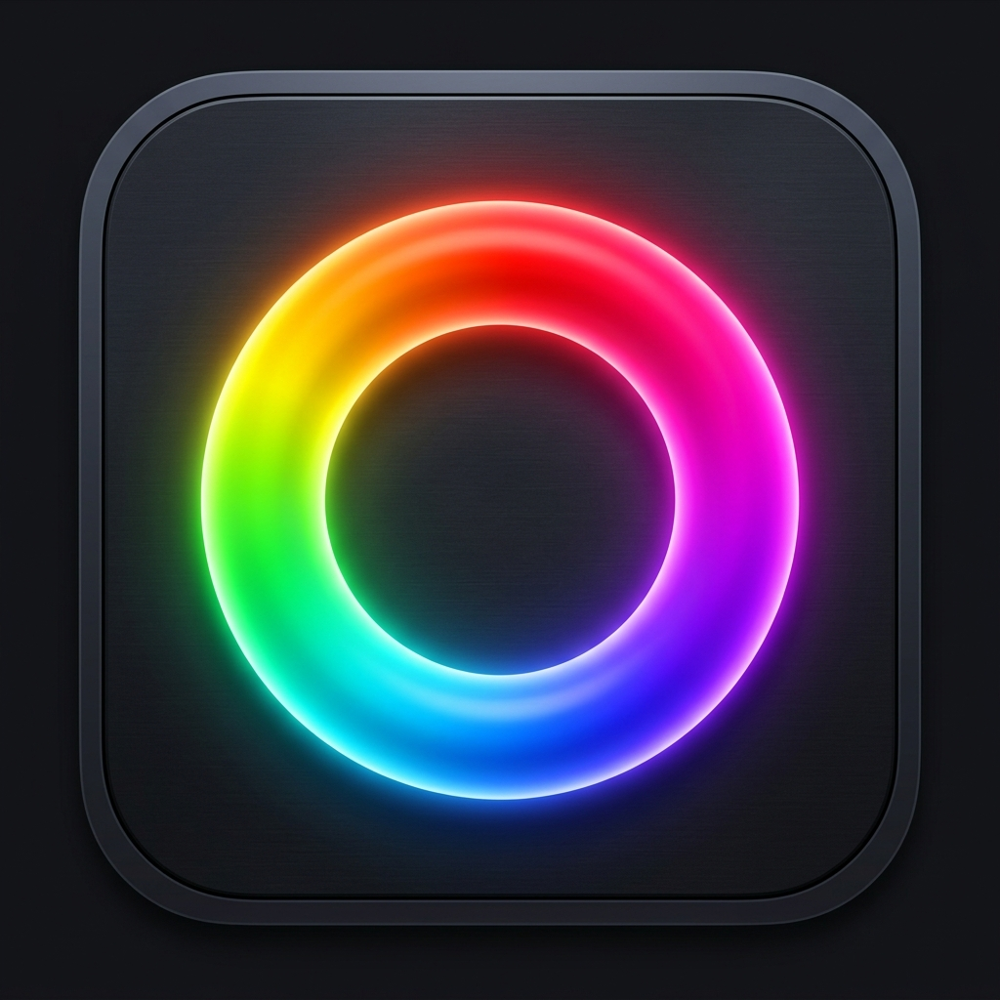

# 🎨 GOM Color Picker Pro — Suite Definitiva de Color & Arte Digital

<div align="center">



### Estación de Trabajo Cromática de Precisión, Armonía y Física del Color para Adobe Photoshop, Artistas Digitales y Pintores Tradicionales

[](https://github.com/GomSamurai/gom-picker)
[](LICENSE)
[](https://github.com/GomSamurai/gom-picker)
[](https://github.com/GomSamurai/gom-picker)
[](https://github.com/GomSamurai/gom-picker)

*Diseñado, investigado y programado por **Fran Gómez** ([@GomSamurai](https://github.com/GomSamurai)).*

[🚀 Inicio Rápido](#-inicio-rápido) • [📦 Modalidades](#-ecosistema-multiplataforma-y-despliegue) • [💎 Módulos de la Suite](#-recorrido-exhaustivo-por-módulos-y-herramientas) • [📖 Manual Completo](MANUAL_DE_USUARIO.md) • [⌨️ Atajos](#️-tabla-maestra-de-atajos-de-teclado)

</div>

---

## 🌟 Visión & Resumen Ejecutivo

**GOM Color Picker Pro** es una estación de trabajo de teoría del color, armonía visual y ciencia cromática concebida para trascender para siempre las limitaciones de los selectores tradicionales. Inspirada en la agilidad de herramientas de culto como *Coolorus*, pero expandida radicalmente con los fundamentos de la física de la luz, la óptica contemporánea y la tradición de los talleres clásicos de pintura.

A diferencia de los selectores convencionales limitados a la mezcla aditiva sRGB —donde mezclar amarillo y azul produce un gris desvitalizado y sucio—, **GOM Color Picker Pro** incorpora un **motor de mezcla sustractiva física basado en ecuaciones de Kubelka-Munk** y catálogo de **más de 120 tubos reales de artista** (Winsor & Newton, Sennelier, Golden, Daniel Smith, Schmincke, Old Holland, etc.) con sus códigos internacionales de **Color Index**, poder de tinción y comportamiento de secado (*dry-down shift*).

Además, integra el **Sistema de las Tres Ruedas de Florent Farges**, **Máscaras de Gamut de James Gurney**, visualización en **espacio cuadridimensional SO(4)** con rotaciones ortogonales en 6 planos, **conversión matemática bidireccional RGB ↔ CMYK con alerta de fuera de gama para imprenta**, simulación de **iluminación atmosférica en ciclo de 24 horas descompuesta en 6 etapas físicas**, **simulador de daltonismo (CVD)** por matrices LMS validadas, **extractor de paletas K-Means**, exportación de **fichas de muestras en resolución 4K y 300 DPI**, y un **Asesor de Composición IA 60-30-10** 100% local, privado y sin dependencias externas.

---

## 📑 Tabla de Contenidos

1. [🚀 Inicio Rápido](#-inicio-rápido)
2. [📦 Ecosistema Multiplataforma y Despliegue](#-ecosistema-multiplataforma-y-despliegue)
   - [1. Aplicación Web & Servidor Local con Live-Reload](#1-aplicación-web--servidor-local-con-live-reload)
   - [2. Aplicación de Escritorio Nativa para Windows (.exe e Instalador)](#2-aplicación-de-escritorio-nativa-para-windows-exe-e-instalador)
   - [3. Versión Portable para Windows (Sin Instalación)](#3-versión-portable-para-windows-sin-instalación)
   - [4. Plugin Nativo UXP para Adobe Photoshop (CC 2021+)](#4-plugin-nativo-uxp-para-adobe-photoshop-cc-2021)
   - [5. Extensión de Navegador Chromium (Chrome, Edge, Brave, Comet)](#5-extensión-de-navegador-chromium-chrome-edge-brave-comet)
   - [6. Ventana Flotante Multimonitor Sincronizada (BroadcastChannel)](#6-ventana-flotante-multimonitor-sincronizada-broadcastchannel)
3. [🏛️ Arquitectura del Sistema](#️-arquitectura-del-sistema)
4. [💎 Recorrido Exhaustivo por Módulos y Herramientas](#-recorrido-exhaustivo-por-módulos-y-herramientas)
   - [Módulo 1: Rueda Cromática Multiespacio & Armonías Vivas](#módulo-1-rueda-cromática-multiespacio--armonías-vivas)
   - [Módulo 2: Espacio Numérico Dual & Gamut Guard (RGB ↔ CMYK)](#módulo-2-espacio-numérico-dual--gamut-guard-rgb--cmyk)
   - [Módulo 3: Máscaras de Gama de James Gurney & Notación Munsell](#módulo-3-máscaras-de-gama-de-james-gurney--notación-munsell)
   - [Módulo 4: Chromilla Studio — Taller de Pintura Física y 120+ Tubos Reales](#módulo-4-chromilla-studio--taller-de-pintura-física-y-120-tubos-reales)
   - [Módulo 5: Sistema Práctico de Teoría del Color de Florent Farges](#módulo-5-sistema-práctico-de-teoría-del-color-de-florent-farges)
   - [Módulo 6: Modificador Dinámico de Luz, Atmósfera & Sombras](#módulo-6-modificador-dinámico-de-luz-atmósfera--sombras)
   - [Módulo 7: Estudio Avanzado de Paletas, Matrices & Optimización](#módulo-7-estudio-avanzado-de-paletas-matrices--optimización)
   - [Módulo 8: Armonizador Multi-Biblioteca & Fusión de Muestras](#módulo-8-armonizador-multi-biblioteca--fusión-de-muestras)
   - [Módulo 9: Hiperespacio 4D — Visualizador Cuadridimensional SO(4)](#módulo-9-hiperespacio-4d--visualizador-cuadridimensional-so4)
   - [Módulo 10: Galería Histórica de Grandes Maestros](#módulo-10-galería-histórica-de-grandes-maestros)
   - [Módulo 11: Extractor K-Means & Análisis de Imagen](#módulo-11-extractor-k-means--análisis-de-imagen)
   - [Módulo 12: Lienzo de Mezcla Física & Espátula Digital (Wet Mixer)](#módulo-12-lienzo-de-mezcla-física--espátula-digital-wet-mixer)
   - [Módulo 13: Rampas Tonales & Generador de Degradados OKLCH](#módulo-13-rampas-tonales--generador-de-degradados-oklch)
   - [Módulo 14: Asesor Cromático IA, Estudio 60-30-10 & Chat Maestro](#módulo-14-asesor-cromático-ia-estudio-60-30-10--chat-maestro)
   - [Módulo 15: Simulador de Daltonismo y Accesibilidad CVD](#módulo-15-simulador-de-daltonismo-y-accesibilidad-cvd)
   - [Módulo 16: Exportador Avanzado de Hojas de Muestras (Swatch Sheets)](#módulo-15-exportador-avanzado-de-hojas-de-muestras-swatch-sheets)
   - [Módulo 17: Nombrador Inteligente Multiestilo & Copias de Perfil](#módulo-17-nombrador-inteligente-multiestilo--copias-de-perfil)
   - [Módulo 18: Importación y Exportación Universal de Formatos](#módulo-18-importación-y-exportación-universal-de-formatos)
5. [⌨️ Tabla Maestra de Atajos de Teclado](#️-tabla-maestra-de-atajos-de-teclado)
6. [📂 Estructura del Proyecto](#-estructura-del-proyecto)
7. [📖 Manual de Usuario y Referencia Técnica](#-manual-de-usuario-y-referencia-técnica)
8. [📜 Licencia y Créditos](#-licencia-y-créditos)

---

## 🚀 Inicio Rápido

### En 1 Clic (Windows) 🌟
Haz doble clic en:
```cmd
INICIAR_GOM_PICKER.bat
```
*(o en `start.bat`)*. Se iniciará automáticamente el servidor local con detección de tipos MIME, soporte para ES Modules, Live-Reload por WebSockets y se abrirá tu navegador predeterminado en `http://localhost:5050`.

### Desde la Terminal (Cualquier Sistema Operativo)
```bash
# 1. Clonar el repositorio
git clone https://github.com/GomSamurai/gom-picker.git

# 2. Acceder al directorio
cd gom-picker

# 3. Iniciar el servidor local de desarrollo
npm start
# (o alternativamente: node local-server.js)
```
Abre en tu navegador favorito: **`http://localhost:5050`**

---

## 📦 Ecosistema Multiplataforma y Despliegue

GOM Color Picker Pro ha sido diseñado con una arquitectura modular desacoplada que le permite ejecutarse en 5 entornos de trabajo diferentes:

```
                               ┌─────────────────────────────────────────────────────┐
                               │             GOM COLOR PICKER PRO CORE               │
                               │  ColorMath • Kubelka-Munk • OKLCH • Munsell • SO(4) │
                               └──────────────────────────┬──────────────────────────┘
                                                          │
          ┌───────────────────────┬───────────────────────┼───────────────────────┬───────────────────────┐
          ▼                       ▼                       ▼                       ▼                       ▼
   [ 🌐 Web App ]       [ 🖥️ Desktop App ]     [ 📦 Portable ]      [ 🎨 Photoshop UXP ]    [ 🧩 Chrome Ext ]
  local-server.js        GOM Picker Pro.exe    Pendrive / No install  manifest.json (v5)     Manifest V3
  Port 5050 / Vercel    Inno Setup Wizard      INICIAR_PORTABLE.bat   Sincronía FG/BG        EyeDropper API
```

### 1. Aplicación Web & Servidor Local con Live-Reload
* **Fichero:** `local-server.js`
* Servidor HTTP ultra-ligero sin dependencias externas (`0 npm dependencies`).
* Puerto asignado: `5050` (evita colisiones con puertos comunes como 3000 u 8080).
* Incluye watcher automático de ficheros (`scripts/`, `styles/`, `index.html`) con recarga en vivo en el navegador mediante `EventSource` / polling limpio.
* Listo para desplegar en plataformas en la nube como Vercel o Netlify (`vercel.json` incluido).

### 2. Aplicación de Escritorio Nativa para Windows (.exe e Instalador)
* **Directorio:** `installer/` y `build/`
* Dispone de ejecutable compilado nativo en C# (`Launcher.cs`) y empaquetado Electron / WebView2 (`GOM Color Picker Pro.exe`).
* Incluye instalador formal de Windows con asistente guiado creado mediante Inno Setup 6 (`setup_standalone.iss` y `setup_script.iss`).
* Iconos de alta resolución (256x256) y metadatos firmados con `rcedit`.

### 3. Versión Portable para Windows (Sin Instalación)
* **Script de compilación:** `scripts/build_portable.ps1`
* Permite llevar la suite completa en una memoria USB o disco externo.
* Se ejecuta mediante `INICIAR_PORTABLE.bat` sin requerir permisos de administrador ni alterar el registro de Windows.

### 4. Plugin Nativo UXP para Adobe Photoshop (CC 2021+)
* **Manifiesto:** `manifest.json` (Manifest V5 para Adobe UXP).
* **Puente de integración:** `scripts/uxpBridge.js`.
* **Cómo instalar:**
  1. Abre **Adobe UXP Developer Tool** (incluido gratuitamente en Adobe Creative Cloud).
  2. Haz clic en **"Add Existing Plugin"** y selecciona la carpeta raíz del proyecto `gom-picker`.
  3. Haz clic en **"Load"** con Photoshop abierto.
  4. La suite se integrará como un panel acoplable o flotante dentro del menú `Ventana > Extensiones (UXP) > GOM Color Picker Pro`.
  5. Sincronización bidireccional inmediata: al seleccionar un color en Photoshop, la rueda y fichas se actualizan; al elegir un color en la suite, las muestras frontal (Foreground) y fondo (Background) de Photoshop se ajustan automáticamente.

### 5. Extensión de Navegador Chromium (Chrome, Edge, Brave, Comet)
* **Directorio:** `extension/`
* Basada en el estándar moderno **Manifest V3**.
* Dispone de pipeta de pantalla completa nativa (**EyeDropper API**) que permite muestrear cualquier color de cualquier ventana o monitor con el atajo global `Ctrl + Shift + E` (o la tecla `I`).
* Incluye mini-rueda de color táctil, visor multiespacio, fórmulas de taller de pintura y rampa de luces/sombras de Sorolla.
* **Instalación:**
  1. Ve a `chrome://extensions` o `edge://extensions`.
  2. Activa el **"Modo de desarrollador"** (Developer mode).
  3. Haz clic en **"Cargar descomprimida"** (Load unpacked) y selecciona la carpeta `extension`.

### 6. Ventana Flotante Multimonitor Sincronizada (BroadcastChannel)
* Al pulsar el botón **"Panel Flotante"** en la barra superior o lateral, se abre una ventana compacta independiente (`popup.html`).
* Ideal para configuraciones multimonitor o para colocar la paleta flotando por encima de lienzos de Photoshop, Krita, Blender o Clip Studio Paint.
* Sincronización instantánea con latencia cero a través de la API `BroadcastChannel`.

---

## 🏛️ Arquitectura del Sistema

```mermaid
flowchart TD
    UI[🖥️ Interfaz de Usuario: index.html & popup.html] --> App[🎯 Orquestador: app.js]
    
    subgraph Motores Científicos y Físicos
        App --> CM[📐 ColorMath.js: RGB, CMYK, HSL, LAB, OKLCH, Munsell]
        App --> KM[🧪 Kubelka-Munk & ChromillaMixer: Mezcla Sustractiva]
        App --> FF[👨‍🎨 FlorentFarges.js: 3 Ruedas, Curvas Bow, Flesh Gamut]
        App --> H4D[🔮 Hyper4D.js: Rotaciones SO4 en 6 planos & Polítopos]
        App --> ATM[🌅 AtmosphereEngine.js: 24h Solar, Rayleigh, 6 Etapas Shading]
        App --> CVD[👁️ CVDSimulator.js: Matrices LMS Brettel / Daltonismo]
    end

    subgraph Gestión de Paletas & Taller
        App --> GM[🎯 GamutMask.js: James Gurney 5 Formas]
        App --> CW[🎨 ColorWheel.js: Triángulo, Caja, RYB, OKLCH]
        App --> BP[🏷️ BrandPigments.js: 120+ Tubos Reales de 10 Marcas]
        App --> PS[🎭 PaletteStudio.js & Matriz NxN de Mezcla]
        App --> LH[⚖️ LibraryHarmonizer.js: Fusión Multi-Biblioteca]
        App --> EX[📷 ImageExtractor.js: K-Means Clustering]
        App --> WM[🖌️ WetMixer.js: Espátula Digital & Óleo Húmedo]
    end

    subgraph Inteligencia & Exportación
        App --> AI[🧠 AIAdvisor.js & AIAssistant.js: Composición 60-30-10]
        App --> AIC[💬 AIChat.js: Chat Híbrido Local / LLM Opcional]
        App --> SWE[📄 SwatchSheetExporter.js: Fichas 4K & A4 300 DPI]
        App --> PI[📥 PaletteImporter.js: .ASE, .GPL, .JSON, .CSS]
        App --> UXP[🔌 UXPBridge.js: Adobe Photoshop CC 2021+]
    end
```



---

## 💎 Recorrido Exhaustivo por Módulos y Herramientas

### Módulo 1: Rueda Cromática Multiespacio & Armonías Vivas
* **4 Modos de Rueda Interactiva:**
  1. **Modo Triángulo (Coolorus Style):** Anillo perimetral de matiz (*Hue*) con triángulo equilátero interno giratorio para saturación y valor. Mantiene la orientación visual del matiz seleccionado en el vértice.
  2. **Modo Cuadrado / Caja (Photoshop & Procreate):** Mapeo rectangular bidimensional clásico (Eje X: Saturación, Eje Y: Valor).
  3. **Modo Rueda de Pintor (RYB):** Espacio sustractivo tradicional basado en los primarios históricos (Rojo, Amarillo, Azul) según las teorías de Itten y Goethe.
  4. **Modo OKLCH Perceptual:** Espacio de color perceptualmente uniforme. Corrige las no-linealidades del ojo humano en el espectro azul/amarillo y garantiza que cambios numéricos iguales produzcan transiciones visuales homogéneas sin saltos de luminosidad aparente.
* **Hero Well & Selector Frontal/Fondo:**
  - Gran visor de color activo conmutador entre Frontal (FG) y Fondo (BG).
  - Rápido intercambio mediante la tecla `X` y restablecimiento a valores por defecto con la tecla `D`.
* **Bandas Compañeras de Valor y Saturación:**
  - Desglose perimetral dinámico con bandas de gradación tonal relativa, pasos de desaturación hacia neutro y comprobador de contraste perceptual con ratios numéricos WCAG 2.1.
* **Superposición de Armonías Vivas sobre la Rueda:**
  - Los marcadores armónicos se dibujan en tiempo real en el canvas:
    * *Monocromático*
    * *Complementario (180°)*
    * *Tríada Equilátera (120° / 240°)*
    * *Análogos (±30°)*
    * *Complementario Dividido / Split Complementary (150° / 210°)*
    * *Tétrada Rectangular*
    * *Armonía Cuadrada (90° / 180° / 270°)*
* **Motor de Tooltips de Inspección Dinámica (`tooltipEngine.js`):**
  - Al posar el cursor sobre cualquier muestra de la suite, aparece una tarjeta flotante de inspección con vista hero, 6 variaciones armónicas en 1 clic (complementario, tríada, análogo, aclarado, oscurecido), notación técnica completa y opción para anclar (`P`).

---

### Módulo 2: Espacio Numérico Dual & Gamut Guard (RGB ↔ CMYK)
* **Entrada y Conversión Multi-Espacio Simultánea:**
  - Modificación en tiempo real en los espacios: **HEX**, **RGB (0-255)**, **CMYK (0-100%)**, **HSL**, **HSV**, **CIELAB** y **OKLCH**.
* **Gamut Guard & Detección de Fuera de Gama para Imprenta:**
  - Detecta inmediatamente si el color seleccionado en pantalla sobrepasa el límite físico de las tintas de cuatricromía (espacio CMYK ISO / Fogra39 / SWOP).
  - Incluye cálculo de TAC (*Total Area Coverage* o cobertura total de tinta).
  - **Botón "Corregir Gamut":** Ejecuta una proyección matemática por mínima distancia perceptual en el espacio CIELAB, atrayendo el color al límite cromático imprimible más cercano sin desvirtuar el matiz artístico.

---

### Módulo 3: Máscaras de Gama de James Gurney & Notación Munsell
* **Máscaras de Gamut de James Gurney (`gamutMask.js`):**
  - Superposición geométrica sobre la rueda cromática para limitar deliberadamente la paleta y forzar una armonía de luz dominante en toda la obra.
  - **5 Formas Geométricas:** Triángulo, Diamante, Hendidura (*Slit*), Sector y Elipse.
  - **Controles Dinámicos:** Rotación angular (0-360°), escala de apertura, desplazamiento excéntrico hacia zonas cálidas o frías y opacidad de la máscara.
  - **Presets Canónicos:** *Atmospheric Mood*, *Dominant Warmth*, *Midnight Mystery*, *Desert Oasis*, *Triadic Limited*, etc.
* **Sistema de Notación Científica Munsell (`munsellSystem.js`):**
  - Desglose tridimensional exacto en coordenadas **Matiz (Hue)**, **Valor (Value 0-10)** y **Croma (Chroma)** (por ejemplo: `5R 4/14` o `10PB 3/8`).
  - Representación del sólido tridimensional asimétrico de Munsell, reconociendo que pigmentos como el amarillo alcanzan su máximo croma a valores lumínicos altos, mientras que el azul ultramar lo hace a valores muy oscuros.

---

### Módulo 4: Chromilla Studio — Taller de Pintura Física y 120+ Tubos Reales
* **Catálogo Auténtico de Tubos Reales de Artista (`brandPigments.js`):**
  - Más de 120 tubos de pintura reales catalogados de las 10 firmas de bellas artes más prestigiosas del mundo:
    * **Winsor & Newton** *(Artists' Oil & Professional Watercolour)*
    * **Sennelier** *(Huile Extra-Fine & L'Aquarelle)*
    * **Golden** *(Heavy Body & Fluid Acrylics)*
    * **Old Holland** *(Classic Oil Colours)*
    * **Rembrandt** *(Royal Talens Artists' Oil)*
    * **Schmincke** *(Mussini Resin-Oil & Horadam Watercolour)*
    * **Daniel Smith** *(Extra Fine Watercolors & PrimaTek)*
    * **Michael Harding** *(Handmade Oil Colours)*
    * **Holbein** *(Artists' Oil & Acryla Gouache)*
    * **Gamblin** *(Artists' Oil Colors)*
* **Datos Técnicos Genuinos por Tubo:**
  - Código internacional **Color Index (CI)**: `PW6` (Blanco Titanio), `PY35` (Amarillo Cadmio), `PR108` (Rojo Cadmio), `PB29` (Azul Ultramar), `PG7` (Verde Ftalocianina), `PBr7` (Siena Tostada), `PBk9` (Negro Marfil), etc.
  - Factores de poder de tinción (*Tinting Strength* de 1 a 10), opacidad física (Opaco, Semi-opaco, Transparente) y clasificación de resistencia a la luz (ASTM I / II).
* **Motor de Mezcla Sustractiva Física Kubelka-Munk:**
  - A diferencia de los modelos lineales RGB, calcula la absorción y dispersión de la luz a través de las partículas de pigmento.
  - Resuelve recetas exactas de taller especificando las partes relativas y porcentajes de cada tubo para recrear el color objetivo.
* **Filtro "Mi Caja de Pinturas" (Studio Paint Box):**
  - Permite al usuario marcar qué tubos posee físicamente en su caballete. Al buscar una mezcla, el algoritmo calcula la receta óptima empleando **únicamente** los tubos de su inventario personal.
* **Simulación de Secado por Médium (Dry-down Shift):**
  - **Óleo (Oil):** Secado prácticamente fiel (shift 1.0).
  - **Acrílico (Acrylic):** Simula el oscurecimiento natural producido cuando la emulsión polimérica lechosa se vuelve transparente (-14% luminosidad, +5% croma).
  - **Acuarela (Watercolor):** Simula el aclarado al evaporarse el agua sobre el papel de algodón (+15% luminosidad, -12% saturación).
  - **Gouache:** Shift tonal dual (los oscuros se aclaran por el blanco de creta y los claros se oscurecen al secar).
* **Escala de Blanqueo a 5 Pasos (+0%, +25%, +50%, +75%, +90%)** y recomendaciones para calentar o enfriar la mezcla en el lienzo.

---

### Módulo 5: Sistema Práctico de Teoría del Color de Florent Farges
* Implementa fielmente la pedagogía moderna del maestro pintor **Florent Farges**:
* **The Three-Wheel System (El Sistema de las Tres Ruedas):**
  1. *Rueda 1:* Posicionamiento angular óptico de los pigmentos de taller y su poder de tinción relativo.
  2. *Rueda 2:* Líneas de mezcla físicas y **Curvas Bow (Bow Curves)** sustractivas (demuestra cómo al mezclar pigmentos complementarios, el valor lumínico desciende en el centro formando una curva de caída no lineal hacia el neutro).
  3. *Rueda 3:* Espiral tridimensional de valor inherente de los pigmentos (desde el amarillo limón en la cima hasta los tierras y negros en la base).
* **Gama Académica de Carnaciones (Flesh Gamut):**
  - Mapeo específico para retratistas: tonos de base, transiciones de medios tonos, zonas vasculares rojizas (nariz, mejillas, orejas), zonas óseas amarillentas y sombras frías o neutras.
* **Laboratorio de Mezcla Bipigmentaria:**
  - Simula la mezcla física entre dos tubos cualesquiera con control de proporción (slider 0-100%) y compensación del poder de tinción no lineal.
* **Explicación Didáctica "El Por Qué de las Cosas":**
  - Diagnósticos explicativos sobre por qué ciertas combinaciones neutralizan rápidamente o por qué los amarillos cadmio requieren proporciones mínimas de azul para virar a verde.

---

### Módulo 6: Modificador Dinámico de Luz, Atmósfera & Sombras
* **Simulación Solar en Ciclo de 24 Horas:**
  - Control de hora del día (0:00 a 24:00) con presets: *Amanecer / Aurora*, *Mediodía Solar*, *Hora Dorada*, *Crepúsculo*, *Hora Azul*, *Noche / Luna Llena* y *Cielo Nublado*.
  - Temperatura de color Kelvin de la luz incidente (2000K a 10000K), elevación y azimut solar.
  - Dispersión de Rayleigh y tinte cromático del domo celeste.
* **Descomposición del Sombreado en 6 Etapas Físicas:**
  1. **Luz Directa (Key Light):** Color local afectado por la temperatura Kelvin de la fuente.
  2. **Color Local (Midtone):** Pigmentación pura en superficies perpendiculares a la luz.
  3. **Terminador (Terminator & SSS):** Frontera crítica entre luz y sombra con pico de saturación por dispersión subsuperficial (*Subsurface Scattering*).
  4. **Sombra de Oclusión (Ambient Occlusion):** Zonas profundas donde no penetra la luz directa ni el rebote.
  5. **Luz de Rebote (Bounce Light / Fill):** Luz reflejada por el suelo o entorno con selector de terreno físico (*Tierra, Hierba, Arena, Nieve, Asfalto, Agua o Personalizado*).
  6. **Brillo Especular (Specular Highlight):** Reflejo directo con tinte de la fuente lumínica.
* **Esfera Óptica 3D Interactiva:**
  - Renderizador volumétrico en tiempo real sobre canvas que proyecta la muestra activa sobre una esfera iluminada tridimensional con todas las capas físicas activables.
* **Efecto Purkinje:**
  - Simula el cambio fisiológico en la visión humana en condiciones de penumbra (transición de conos a bastones con mayor sensibilidad hacia el espectro azul).
* **Estudio Global de Tinte, Veladuras (Glazes) & Split-Toning:**
  - Aplica filtros de iluminación globales a la escena con modos de fusión (*Soft Light, Multiply, Overlay, Color, Screen*) y tintado disociado entre luces y sombras.

---

### Módulo 7: Estudio Avanzado de Paletas, Matrices & Optimización
* **Matriz de Mezcla Bidimensional Sustractiva (NxN):**
  - Genera automáticamente la carta de mezclas completa entre todos los pigmentos de la paleta activa en pasos porcentuales (100:0, 75:25, 50:50, 25:75, 0:100).
* **Análisis de Gamut Hull:**
  - Calcula y visualiza el polígono de cobertura cromática que la paleta seleccionada puede abarcar en el espacio tonal.
* **Catálogo Canónico de Paletas Históricas de Taller:**
  - *Paleta Zorn* (Anders Zorn: 4 tubos canónicos con negro marfil como azul frío).
  - *Tetracromatismo de Apeles* (Grecia Clásica: Leukon, Ochra, Sinopis, Melas).
  - *Tenebrismo Caravaggesco* (Caravaggio: claroscuro extremo y tierras densas).
  - *Paleta de Corte de Velázquez* (Diego Velázquez: grises plateados y armonías sobrias).
  - *Luminismo de Sorolla* (Joaquín Sorolla: sol ardiente, violetas y sombras calientes).
  - *Claroscuro Barroco de Rembrandt* (Rembrandt: veladuras doradas y siena tostada).
  - *Impresionismo al Aire Libre de Monet* (Claude Monet: eliminación de negros y sombras coloreadas).
* **Optimizador Algorítmico de Paletas (`PaletteOptimizer`):**
  - Evalúa cualquier paleta con un puntaje de calidad armónica de 0 a 100 y medalla de rango (**S+, A, B, C, D**).
  - Analiza balance térmico, diversidad de valor tonal, saturación y contraste de croma, ofreciendo sugerencias matemáticas de equilibrio.
* **Menú Contextual Universal y Gestión Quirúrgica de Muestras e Historial:**
  - Clic derecho universal sobre cualquier muestra: permite **eliminar muestra** de bibliotecas o paletas con un solo clic (y personalizar catálogos de fábrica clonándolos automáticamente sin la muestra).
  - En el historial reciente: opción en el clic derecho para **eliminar muestra del historial**, selección múltiple interactiva con `Ctrl + Click` o `Shift + Click`, botón de eliminación selectiva `✕` / tecla `Supr` (`Delete`), botón flotante `×` en cada pastilla y sistema de `↩️ Deshacer` multicapa.

---

### Módulo 8: Armonizador Multi-Biblioteca & Fusión de Muestras
* **Muelle Activo Multi-Biblioteca (`libraryHarmonizer.js`):**
  - Permite cargar y poner en común **cualquier número de bibliotecas de color simultáneamente** (paletas de usuario, maestros históricos, catálogos Copic/Pantone, o tubos reales de artista).
  - Ponderación de influencia individual por biblioteca ($0.2\times$ a $2.0\times$), selector de inclusión/exclusión de muestras y sistema de fijado inmutable (Pin 📌) para proteger tonos clave.
* **7 Estrategias Matemáticas & Físicas de Armonización Cruzada:**
  1. *Veladura Atmosférica & Tinte Común:* Baña todas las muestras en una misma luz con modos de fusión (*Soft Light, Multiply, Overlay, Color, Kubelka-Munk*) y soporte de split-toning.
  2. *Proyección a Máscaras de Gamut:* Fuerza a todas las bibliotecas a cohabitar dentro de un gamut geométrico estricto (triángulo, diamante, hendidura, sector, elipse).
  3. *Sintonización a un Ancla Maestra:* Alinea los matices hacia acordes armónicos exactos (análogos, split-complementarios, tríadas, tétradas o monocromático) respecto a un color ancla o el color frontal activo.
  4. *Normalización Tonal OKLCH:* Unifica sombras y luces focales a lo largo de curvas en S o proporción áurea, y establece techos de croma para eliminar discordancias estridentes.
  5. *Unificación Pigmentaria de Taller:* Simula la adición molecular sustractiva de una pizca de un mismo pigmento aglutinante (Ocre Amarillo, Sombra Tostada, Blanco Titanio, etc.).
  6. *Sintonización Térmica (Sorolla):* Ajusta la temperatura en grados Kelvin polarizando luces cálidas y sombras frías.
  7. *Asignación Jerárquica 60-30-10:* Regula el croma reservándolo al 10% de acentos focales y dejando un 60% de base atmosférica desaturada.
* **Radar Polar de Convergencia & Cohesión Inter-Bibliotecas:**
  - Canvas 2D interactivo que mapea la migración vectorial de las muestras y la reducción del Gamut Hull conjunto antes y después de armonizar.
  - Medidor de índice de cohesión de 0 a 100 (Grados S+ a D) con informe diagnóstico académico.
* **Hub de Generación de Salida & Fusión:**
  - *Crear Nueva Biblioteca Común Armonizada:* Guarda la fusión con opciones de deduplicación perceptual ($\Delta E > 4$) o extracción de paleta resumen de consenso (K-Means de 8 tonos).
  - *Actualización en Lote:* Actualiza directamente las paletas de usuario seleccionadas o las clona con el prefijo `[Armonizada]`.
  - *Extracción de Acentos:* Calcula automáticamente una minipaleta de contrapunto complementario de alto impacto visual.

---

### Módulo 9: Hiperespacio 4D — Visualizador Cuadridimensional SO(4)
* **Motor Cuadridimensional Auténtico (`hyper4d.js`):**
  - Proyecta los colores en el espacio hiperdimensional **SO(4)** mediante matrices de rotación ortogonales en **6 planos independientes**:
    * Planos tridimensionales: `XY`, `XZ`, `YZ`.
    * Planos hiperdimensionales: `XW`, `YW`, `ZW`.
* **La 4ª Dimensión (Eje W) Multivariable:**
  - *Modo Térmico:* El eje W representa la temperatura de color en grados Kelvin.
  - *Modo Sustractivo:* El eje W representa la densidad de veladura o absorción pigmentaria.
  - *Modo Tesseract:* Hiper-rotación geométrica pura en el espacio euclídeo tetradimensional.
  - *Modo Diurno:* El eje W modela la posición en el ciclo solar de 24 horas.
* **7 Modos de Despliegue Espacial:**
  1. *Armonías 4D*
  2. *Paletas & Proyecciones*
  3. *Rampas Tonales Tridimensionales*
  4. *Luz y Sombra Gurney*
  5. *Curva Bow de Florent Farges*
  6. *Multicomparador de Muestras*
  7. *Tesseract SO(4)*
* **Visualización de Polítopos 4D Regulares:**
  - Proyección ortogonal y estereográfica de politopos cuadridimensionales: **Tesseract (8-Cell)**, **16-Cell**, **24-Cell**, **120-Cell** y **600-Cell**.
* **Motor Gráfico Avanzado a 60 FPS:**
  - Iluminación volumétrica Phong 3D con niebla de profundidad cósmica.
  - Cámara suave con interpolación (*lerp*) y modo cinemático de vuelo orbital (*fly-through*).
  - Cápsulas de cristal anti-colisión para etiquetas de muestras y líneas guía tridimensionales.

---

### Módulo 10: Galería Histórica de Grandes Maestros
* **Colección de Obras Maestras Analizadas:**
  - Extracción canónica de paletas a partir de análisis histórico y cromatográfico de lienzos originales:
    * **Claude Monet** (*Nenúfares* — Impresionismo)
    * **Vincent van Gogh** (*La Noche Estrellada* y *Los Girasoles* — Postimpresionismo)
    * **Rembrandt van Rijn** (*Retrato de Anciano* y *Lección de Anatomía* — Claroscuro)
    * **Joaquín Sorolla** (*Paseo a Orillas del Mar* — Luminismo)
    * **John Singer Sargent** (*Madame X* y *Carnation, Lily, Lily, Rose* — Retrato Realista)
    * **Johannes Vermeer** (*La Joven de la Perla* — Luz del Norte)
    * **Katsushika Hokusai** (*La Gran Ola de Kanagawa* — Ukiyo-e)
    * **Gustav Klimt** (*El Beso* — Simbolismo Dorado)
    * **Alphonse Mucha** (*Las Estaciones* — Art Nouveau)
    * **Leonardo da Vinci** (*La Gioconda* — Sfumato)
    * **Caravaggio** (*Judit y Holofernes* — Tenebrismo)
    * **Caspar David Friedrich** (*El Caminante sobre el Mar de Nubes* — Romanticismo)
    * **J.M.W. Turner** (*Lluvia, Vapor y Velocidad* — Expresionismo Atmosférico)
* **Visor Modal de Pantalla Completa:**
  - **Lienzo interactivo HD:** Explora la pintura en alta resolución.
  - **Pipeta en Vivo sobre el Cuadro:** Muestrea cualquier píxel del óleo original con lupa de aumento.
  - **Ficha Técnica & Curaduría:** Pigmentos históricos documentados de la época, método de mezcla del maestro y consejos contemporáneos para pintura digital.
  - **Carga Inmediata:** Vuelca la paleta canónica del maestro al estudio de trabajo con un solo clic.
  - Posibilidad de añadir obras maestras y catálogos personalizados propios.

---

### Módulo 11: Extractor K-Means & Análisis de Imagen
* **Importación Drag & Drop, Archivos y Carpetas Completas:**
  - Arrastra y suelta imágenes individuales (JPG, PNG, WebP, SVG, BMP) o utiliza la API del sistema `showDirectoryPicker()` para escanear y procesar carpetas completas de referencias de forma recursiva.
* **Suite Completa de Herramientas de Selección Espacial:**
  - **Pipeta en Vivo (`eyedropper`):** Muestreo directo por clic del color exacto de cualquier píxel.
  - **Marco Rectangular (`rect` - tecla M):** Aísla encuadres cuadrangulares con precisión milimétrica.
  - **Marco Elíptico (`ellipse`):** Selección circular u ovalada perfecta para rostros, frutas o iris.
  - **Lazo Libre (`lasso` - tecla L):** Traza selecciones continuas a mano alzada.
  - **Lazo Poligonal (`polygon`):** Define vértices sucesivos con cierre automático por proximidad o doble clic.
  - **Pincel de Selección Directa (`brush_sel` - tecla B):** Pinta áreas de selección con radio ajustable (6px a 80px).
* **Combinación Multi-Zona Booleana:**
  - **Nueva Selección (`new`):** Reemplaza el área activa anterior.
  - **Añadir a la Selección (`add` / Shift):** Une múltiples regiones inconexas (por ejemplo, cabellos + ropaje + fondo) mediante composición `source-over`.
  - **Restar de la Selección (`sub` / Alt):** Sustrae áreas mediante operación `destination-out`.
  - **Invertir Selección & Deseleccionar todo (`Ctrl+D`):** Manipulación instantánea del búfer de selección en memoria.
* **Máscaras de Exclusión Rubí (*Ruby Quick Mask*):**
  - **Pincel de Máscara (`mask_brush` - tecla X) & Borrador (`mask_eraser`):** Pinta zonas de exclusión con tinte visual carmesí semitransparente.
  - El motor K-Means prohíbe de forma estricta que los píxeles enmascarados formen parte del muestreo o de los racimos generados.
  - Controles de visibilidad (`👁️ Ver`), inversión de máscara y limpieza total.
* **Motor de Zoom & Navegación Fluida:**
  - Zoom dinámico de $0.2\times$ a $12.0\times$ centrado en la posición del cursor mediante rueda de ratón o herramienta Lupa (`zoom` - tecla Z).
  - Panning fluido tipo Photoshop: mantén la **Barra Espaciadora** o activa la herramienta Mano (`pan` - tecla H).
  - Botones de acceso rápido: `⛶ Ajustar` al contenedor (tecla 0) y `1:1` tamaño real píxel a píxel.
* **Lupa de Inspección Flotante HUD (*Precision Loupe*):**
  - Parche magnificador $4\times$ en tiempo real con retícula de cruz central, coordenadas $(X, Y)$ del lienzo original y visualizador HEX continuo.
* **Motor 100% Determinista, Invariable y Fiel (Cero Aleatoriedad):**
  - Eliminación absoluta de inicializaciones estocásticas (`Math.random()`). El algoritmo garantiza una **reproducibilidad matemática perfecta y bit a bit**: analizar la misma imagen hoy o meses después con los mismos parámetros arroja con exactitud absoluta las mismas muestras de color.
* **8 Presets Fieles Especializados:**
  - **🎨 Maestro Equilibrado (Fidelidad Pro):** Equilibrio óptimo entre dominancia visual y acentos cromáticos armónicos.
  - **👑 Dominancia Pura / Frecuencia:** Prioriza estrictamente los colores con mayor volumen físico y superficie de píxeles.
  - **✨ Alta Saturación & Énfasis:** Rescata tonos cromáticos vivos, detalles puros y acentos expresivos.
  - **👤 Academia & Retrato (Carnaciones):** Calibrado para la tez humana, luces cálidas y semitonos académicos (Farges/Zorn).
  - **🌓 Rango Tonal Completo:** Partición espectral según el Sistema de Zonas (luces altas, mediotonos y sombras profundas).
  - **🍬 Pasteles & Atmósfera Suave:** Altas luces aterciopeladas y saturación moderada (impresionismo, acuarela, bruma).
  - **⚡ Alto Contraste:** Polariza la gama entre los extremos más luminosos y más oscuros.
  - **📐 Geometría Median Cut (MMCQ):** Cuantización ortogonal volumétrica estándar de la industria.
* **5 Métodos de Extracción Matemática Configurables:**
  - **K-Means Determinista (Picos 3D):** Siembra de centroides basada en las modas reales de densidad del histograma y refinamiento iterativo Redmean/CIEDE2000.
  - **K-Means Determinista (Voronoi Furthest-Point):** Algoritmo de Gonzalez para máxima cobertura geométrica de la gama.
  - **Corte Medio Modificado (MMCQ / Median Cut):** Partición ortogonal iterativa de cajas RGB por varianza máxima.
  - **Picos de Histograma Perceptual Lab:** Detección directa de modas con supresión de no-máximos ($\Delta E$).
  - **Cuantización Octree Jerárquica:** Reducción en árbol octal de 8 niveles.
* **Calibración de Precisión y Tolerancia de Unicidad $\Delta E$:**
  - Niveles de muestreo: **Ultra** (~20.000 px), **Fina** (~8.500 px) y **Rápida** (~4.000 px).
  - Filtro de unicidad en espacio OKLab: **Estricta** ($\Delta E = 0.045$), **Equilibrada** ($\Delta E = 0.075$) y **Distintiva** ($\Delta E = 0.120$).
* **6 Criterios de Ordenación Perceptual:** Dominancia, Luminosidad Asc/Desc, Matiz (Hue), Saturación, Temperatura y Secuencia Armónica.
* **Integración Integral en la Suite:**
  - Proyección en 1-clic de la paleta extraída a: **Hiperespacio 4D** (Constelaciones), **Curvas Florent Farges**, **Rampas Tonales OKLCH**, **Lienzo Wet Mixer** (depósito automático de manchas) y **Bibliotecas .ASE**.

---

### Módulo 12: Lienzo de Mezcla Física & Espátula Digital (Wet Mixer)
* **Simulación de Paleta de Pintor Húmeda (`wetMixer.js`):**
  - Lienzo interactivo donde mezclar colores aplicando la física sustractiva real de Kubelka-Munk.
* **Herramientas de Taller:**
  - **Espátula de Óleo Biselada (*Palette Knife*):** Crea mezclas densas y firmes con efecto de impasto.
  - **Pincel Mop / Filbert:** Funde bordes con una difusión aterciopelada y continua.
  - **Montículo de Pintura Fresca (*Dab*):** Deposita una masa de pigmento puro del color activo en el lienzo.
  - **Pipeta de Muestreo (*Sampler*):** Toma el color exacto resultante de la mezcla física.
* **Parámetros Físicos:**
  - Control de viscosidad, tamaño del útil, suavidad/difuminado (0.10 a 0.95) y flujo de humedad.
  - Capa de pigmentos pura desacoplada que evita ensuciar o mezclar el fondo oscuro de la paleta.

---

### Módulo 13: Rampas Tonales & Generador de Degradados OKLCH
* **Degradados Perceptuales sin Zona Gris (`rampStudio.js`):**
  - Genera transiciones cromáticas en espacio perceptual **OKLCH** y mezclas pigmentarias sustractivas.
  - Elimina por completo el "agujero gris desaturado y sucio" que ocurre en la interpolación lineal RGB habitual.
* **Control de Pasos y Curvas de Aceleración:**
  - Paradas discretas configurables (de 3 a 16 pasos tonales).
  - Curvas de interpolación lineal o curvas S suaves (*S-curve easing*).
* **Exportación Inmediata:**
  - Copia instantánea de código CSS (`linear-gradient(...)`), SVG vectorial o descarga de tira en PNG.

---

### Módulo 14: Asesor Cromático IA, Estudio 60-30-10 & Chat Maestro
* **Asesor Cromático 100% Local & Privado (`aiAdvisor.js`):**
  - Zero APIs externas, latencia cero y total privacidad.
  - Proyección vectorial semántica NLP que analiza conceptos artísticos, atmósferas y emociones (por ejemplo: *"bosque otoñal en penumbra"*, *"armadura de obsidiana con destellos de plasma"*, *"retrato veneciano"*).
* **Estudio de Composición 60 • 30 • 10 (`aiAssistant.js`):**
  - Aplica la regla áurea del diseño: **60% Color Dominante de Base**, **30% Color Secundario Estructural**, y **10% Color de Acento Focal**.
  - **6 Maquetas Vectoriales Interactivas en Tiempo Real:**
    1. 🐉 *Criatura / Dragón en Caverna de Obsidiana*
    2. 🏞️ *Paisaje Natural y Domo Celeste*
    3. 👤 *Retrato y Figura Humana*
    4. 📐 *Cartel Gráfico y Branding Bauhaus*
    5. 🌃 *Escena Sci-Fi / Cyberpunk Nocturna*
    6. 🏺 *Bodegón Clásico / Naturaleza Muerta*
* **Chat Maestro Híbrido (`aiChat.js`):**
  - Consultor artístico interactivo con motor local académico offline integrado.
  - Conexión opcional con modelos de nube (Google Gemini 2.5 / OpenAI) mediante API key del usuario.
  - Reconoce el contexto vivo de la suite: color seleccionado, armonía activa, coordenadas Munsell y alertas de gamut.

---

### Módulo 15: Simulador de Daltonismo y Accesibilidad CVD
* **Transformaciones Científicas LMS (`cvdSimulator.js`):**
  - Basado en los modelos matemáticos de Brettel, Machado y Viénot.
* **Simulación de 4 Deficiencias Visuales:**
  - **Deuteranopía (Verde):** Ausencia de conos M (~6% varones).
  - **Protanopía (Rojo):** Ausencia de conos L (~2% varones).
  - **Tritanopía (Azul):** Ausencia de conos S (~0.01% global).
  - **Acromatopsia / Monocromo:** Visión puramente en luminosidad y valor tonal sin percepción cromática.
* **Matriz Comparativa 2x2 & Filtro SVG Global:**
  - Muestra una tabla comparativa con el color original frente a las 4 visiones.
  - Botón de filtro SVG global que altera la interfaz completa en tiempo real para verificar la accesibilidad visual de interfaces o ilustraciones.

---

### Módulo 16: Exportador Avanzado de Hojas de Muestras (Swatch Sheets)
* **Generador de Fichas de Especificación Gráfica (`swatchSheetExporter.js`):**
  - Crea láminas de color de calibre editorial para presentaciones a clientes, dirección de arte, manuales de marca y carpetas de producción.
* **7 Plantillas Profesionales:**
  1. *Cinematic Pro 60-30-10 & Golden Ratio (16:9 / 4K)*
  2. *Ficha Enciclopédica Definitiva* (con todas las métricas: HEX, RGB, CMYK, HSL, LAB, OKLCH, Munsell)
  3. *Fine Art Atelier & Real Pigments* (fórmulas con tubos reales, marcas, códigos CI y opacidad)
  4. *Technical Print Spec / Brand Guidelines* (porcentajes de cuatricromía, TAC y contrastes WCAG)
  5. *Specimen Grid Gallery* (retícula modular uniforme de especímenes)
  6. *Editorial Moodboard & Concept Art* (cartel minimalista con brújula de armonía)
  7. *Plantilla Personalizada de Usuario*
* **Temas Visuales:** *Obsidian Dark Studio*, *Papel Bellas Artes*, *Cyberpunk Neon*, *Minimalist White*.
* **Resoluciones de Exportación:** Full HD (1920x1080), 4K UHD (3840x2160), y **A4 a 300 DPI** para impresión directa.
* **Formatos de Salida:** PNG de ultra-alta definición, SVG vectorial, PDF imprimible y copia directa de la imagen al portapapeles.

---

### Módulo 17: Nombrador Inteligente Multiestilo & Copias de Perfil
* **Nombrador Inteligente de Muestras (`smartColorNamer.js`):**
  - Bautiza cualquier color instantáneamente según 8 convenciones de nomenclatura:
    1. *Pigmento al Óleo Genuino* (ej. Azul Ultramar PB29, Siena Tostada PBr7).
    2. *Acuarela Botánica Tradicional* (ej. Verde Savia Genuino, Rosa Ópera).
    3. *Tokens de Diseño Gráfico & UI* (ej. Cyber Indigo, Neon Coral).
    4. *Pantone Formula Guide* (ej. PANTONE 286 C Royal Blue).
    5. *Rotulador Copic Sketch* (ej. B29 Night Blue, E37 Sepia).
    6. *Tubo Comercial de Bellas Artes* (Winsor & Newton, Sennelier, Schmincke, etc.).
    7. *Poesía Atmosférica & Cinematográfica* (ej. Crepúsculo Ámbar, Bruma Nórdica).
    8. *Notación Científica Munsell* (ej. 5PB 4.2/10).
* **Gestor de Copias de Seguridad de Perfil (`profileBackup.js`):**
  - Exportación e importación en 1 clic de un archivo JSON completo que resguarda todas las paletas personalizadas, catálogos propios, historial, configuraciones de IA y preferencias de la estación de trabajo.

---

### Módulo 18: Importación y Exportación Universal de Formatos
* **Formatos de Importación Compatibles (`paletteImporter.js`):**
  - **`.ase` (Adobe Swatch Exchange):** Parser binario directo compatible con archivos de paleta de Adobe Photoshop, Illustrator e InDesign.
  - **`.gpl` (GIMP Palette):** Compatible con Krita, GIMP, Aseprite y Clip Studio Paint.
  - **`.json`:** Tokens de diseño y paletas estructuradas.
  - **`.css` / `.scss`:** Hojas de estilo con variables de color `:root`.
  - **Listas de Texto y Códigos HEX:** Detección automática por expresiones regulares.
  - **Deduplicación Perceptual:** Filtro inteligente mediante distancia Delta-E (CIEDE2000).
* **Formatos de Exportación Disponibles (`swatches.js`):**
  - Adobe Swatch Exchange (`.ase`)
  - GIMP / Krita (`.gpl`)
  - Variables CSS (`:root { --color-1: #...; }`)
  - Archivo de datos JSON
  - Ficha visual SVG y Lámina PNG / PDF de alta definición

---

## ⌨️ Tabla Maestra de Atajos de Teclado

| Tecla / Atajo | Entorno | Acción |
| :---: | :---: | :--- |
| **`X`** | Suite & Extensión | Intercambiar color frontal (Foreground) y de fondo (Background). |
| **`D`** | Suite | Restablecer colores por defecto (Índigo y Carmesí). |
| **`V`** | Suite | Alternar modo de comprobación de valores tonales en Blanco y Negro (B&W Check). |
| **`P`** | Suite | Fijar o desanclar el tooltip flotante de inspección cromática. |
| **`Tab`** | Suite | Alternar la visibilidad de las columnas laterales para maximizar el área de trabajo. |
| **`Enter`** | Suite (Asesor IA) | Sintetizar esquema cromático tras escribir una petición semántica. |
| **`Ctrl + Shift + E`** | Extensión Navegador | Activar la pipeta nativa de pantalla (EyeDropper) para muestrear cualquier píxel. |
| **`I`** | Extensión Navegador | Activar la pipeta cuentagotas dentro del popup de la extensión. |
| **`Ctrl + Shift + Y`** | Extensión Navegador | Abrir o cerrar el popup de la extensión. |
| **`C`** | Extensión Navegador | Copiar el valor HEX activo al portapapeles. |
| **`Esc`** | Suite | Cerrar modales abiertos (Obras Maestras, Hojas de Muestras, Importador, etc.). |

---

## 📂 Estructura del Proyecto

```
gom-picker/
├── index.html                   # Interfaz de trabajo principal de la suite (HTML5 / ES Modules)
├── popup.html                   # Ventana flotante compacta multimonitor (BroadcastChannel)
├── local-server.js              # Servidor HTTP local zero-dependencies con MIME types y Live-Reload
├── INICIAR_GOM_PICKER.bat       # Lanzador en 1 clic para Windows
├── start.bat                    # Script alternativo de arranque rápido
├── package.json                 # Metadatos del proyecto y scripts npm
├── manifest.json                # Manifiesto V5 para Adobe Photoshop UXP Plugin
├── vercel.json                  # Configuración de despliegue en la nube (Vercel)
├── LICENSE                      # Licencia MIT de código abierto
├── MANUAL_DE_USUARIO.md         # Manual exhaustivo de usuario y referencia técnica
├── assets/
│   ├── icon_dark.png            # Icono institucional de alta resolución
│   └── samples/                 # Obras de arte maestras digitalizadas en alta resolución
│       ├── monet.png, rembrandt.png, sorolla.png, sargent.png, etc.
├── styles/
│   └── main.css                 # Sistema de diseño Obsidian Dark Studio, temas y animaciones
├── scripts/
│   ├── app.js                   # Orquestador maestro de la suite
│   ├── colorMath.js             # Motor matemático: RGB, CMYK, HSL, LAB, OKLCH, RYB y Munsell
│   ├── colorWheel.js            # Renderizador interactivo de rueda (Triángulo, Caja, RYB, OKLCH)
│   ├── harmonies.js             # Motor de armonías geométricas y superposiciones en canvas
│   ├── companionBands.js        # Bandas de valor relativo, saturación y contraste WCAG 2.1
│   ├── atmosphereEngine.js      # Motor atmosférico: Ciclo 24h, Kelvin, 6 etapas shading y esfera 3D
│   ├── gamutMask.js             # Máscaras de Gamut de James Gurney (5 geometrías)
│   ├── munsellSystem.js         # Sistema de notación científica Hue/Value/Chroma de Munsell
│   ├── brandPigments.js         # Base de datos de 120+ tubos reales de 10 marcas mundiales
│   ├── paintMixerChromilla.js   # Mezclador sustractivo Kubelka-Munk, recetas reales y dry-down shift
│   ├── florentFarges.js         # Sistema de las 3 Ruedas, curvas bow y carnaciones de Florent Farges
│   ├── hyper4d.js               # Hiperespacio 4D del Color: Rotaciones SO(4), 6 planos y polítopos
│   ├── masterPalettes.js        # Catálogo histórico de obras maestras y visor en alta definición
│   ├── paletteStudio.js         # Estudio de paletas, matrices NxN y cobertura de gamut hull
│   ├── libraryHarmonizer.js     # Armonizador multi-biblioteca: veladuras, gamut, OKLCH y fusión
│   ├── paletteOptimizer.js      # Optimizador armónico algorítmico y puntuación de calidad (S+ a D)
│   ├── paletteImporter.js       # Importador universal (.ASE, .GPL, .JSON, .CSS, texto/HEX)
│   ├── limitedPalettes.js       # Paletas limitadas académicas (Zorn, Apeles, primarios)
│   ├── wetMixer.js              # Lienzo de mezcla física al óleo con espátula digital
│   ├── rampStudio.js            # Generador de rampas perceptuales OKLCH y degradados sin zona gris
│   ├── imageExtractor.js        # Extractor K-Means de imágenes y cuentagotas con lupa digital
│   ├── aiAdvisor.js             # Motor de inteligencia cromática semántica local (NLP)
│   ├── aiAssistant.js           # Estudio de composición 60-30-10 con 6 maquetas vectoriales
│   ├── aiChat.js                # Chat maestro híbrido: Asistente local offline y LLM en la nube
│   ├── cvdSimulator.js          # Simulador de daltonismo y accesibilidad con matrices LMS validadas
│   ├── swatches.js              # Gestor de bibliotecas de usuario y exportador a .ASE / .GPL
│   ├── swatchSheetExporter.js   # Generador de hojas de muestras 4K y A4 300 DPI (7 plantillas)
│   ├── smartColorNamer.js       # Nombrador cromático inteligente en 8 convenciones de la industria
│   ├── profileBackup.js         # Exportador e importador integral de copias de seguridad JSON
│   ├── tooltipEngine.js         # Fichas flotantes interactivas de inspección en muestras
│   └── uxpBridge.js             # Puente de comunicación bidireccional con Adobe Photoshop UXP
├── extension/                   # Extensión para navegadores Chromium (Manifest V3)
│   ├── manifest.json            # Configuración de permisos y EyeDropper API
│   ├── popup.html, popup.js     # Interfaz compacta de extensión de navegador
│   ├── content.js, background.js# Scripts de comunicación y atajos globales
│   └── icons/                   # Iconos empaquetados para la barra del navegador
└── installer/                   # Instalador y empaquetador de escritorio para Windows
    ├── Launcher.cs              # Lanzador nativo de Windows compilado en C#
    ├── setup_standalone.iss     # Script de Inno Setup 6 para el instalador guiado
    ├── setup_script.iss         # Script alternativo de instalación
    └── GOM Color Picker Pro.exe # Ejecutable de escritorio independiente
```

---

## 📖 Manual de Usuario y Referencia Técnica

Para una explicación exhaustiva de cada botón, fórmula matemática, ecuación física de Kubelka-Munk, rotaciones tetradimensionales en SO(4), guías paso a paso para artistas de concept art, ilustradores, pintores al óleo y diseñadores gráficos, consulta el manual completo en:

👉 **[MANUAL DE USUARIO Y REFERENCIA TÉCNICA (MANUAL_DE_USUARIO.md)](MANUAL_DE_USUARIO.md)**

---

## 📜 Licencia y Créditos

Este proyecto se distribuye bajo la licencia **MIT de código abierto**. Consulta el archivo [LICENSE](LICENSE) para más detalles.

### Reconocimientos & Fundamentos Teóricos
* **James Gurney:** Por la creación y divulgación del método de las Máscaras de Gamut (*Color and Light: A Guide for the Realist Painter*).
* **Florent Farges:** Por el desarrollo del *Three-Wheel System*, las curvas *bow* de caída sustractiva y la didáctica moderna de la pintura de caballete.
* **Paul Kubelka y Franz Munk:** Por la formulación matemática de la óptica sustractiva de capas reflectantes y pigmentos opacos (1931).
* **Albert Henry Munsell:** Por el sistema tridimensional de notación cromática *Hue/Value/Chroma* (1905).
* **Björn Ottosson:** Por el desarrollo del espacio de color perceptual uniforme **Oklab / OKLCH** (2020).

---

<div align="center">

Desarrollado con devoción por el arte, la física y el color por **Fran Gómez** ([@GomSamurai](https://github.com/GomSamurai)).

**GOM Color Picker Pro** — *Elevando el color digital a la maestría del arte clásico.*

</div>
